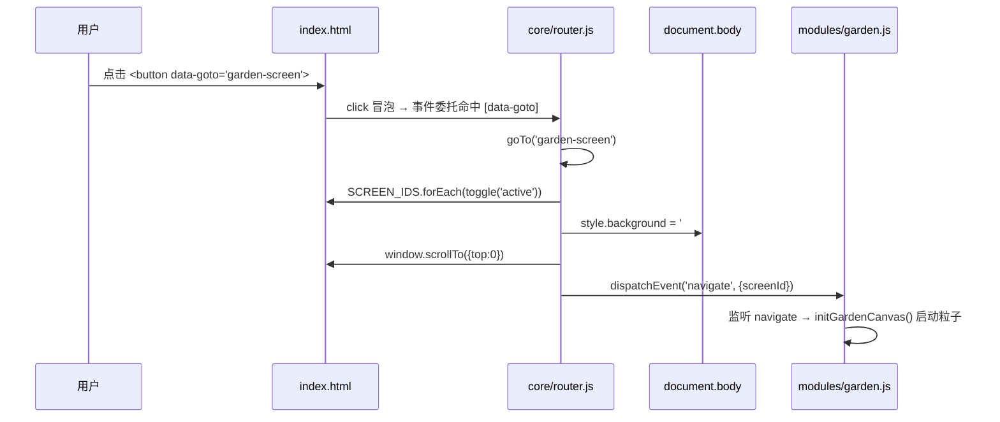
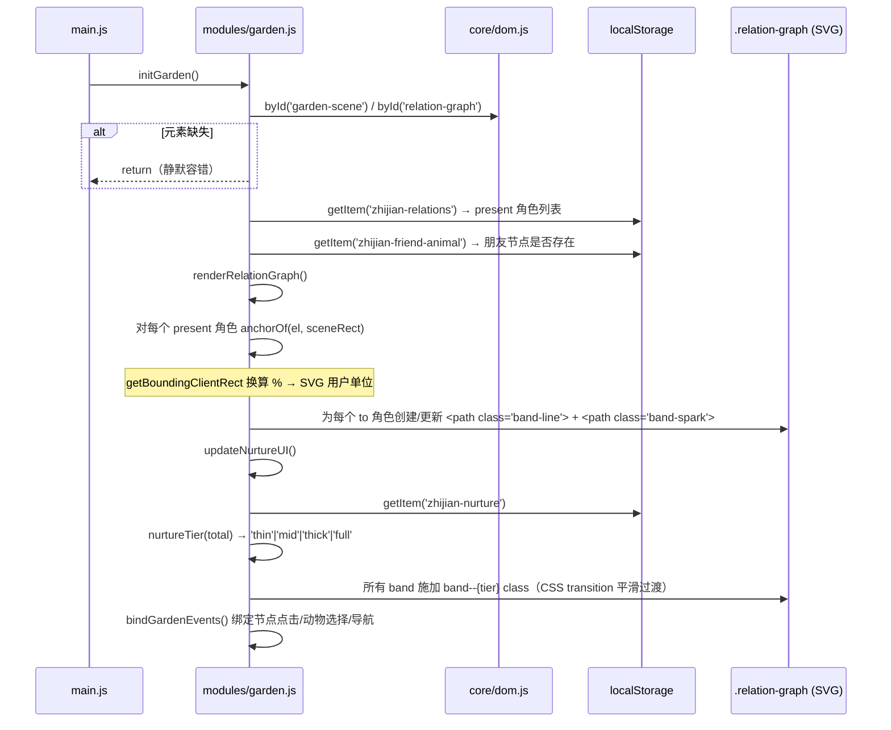
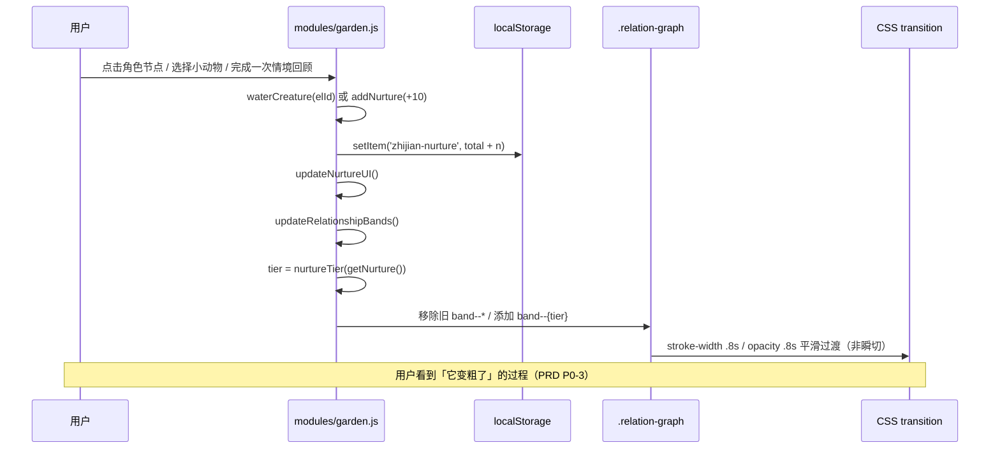
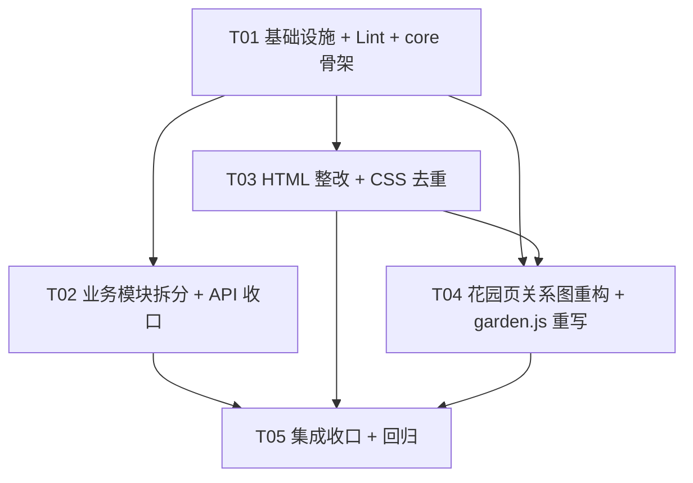
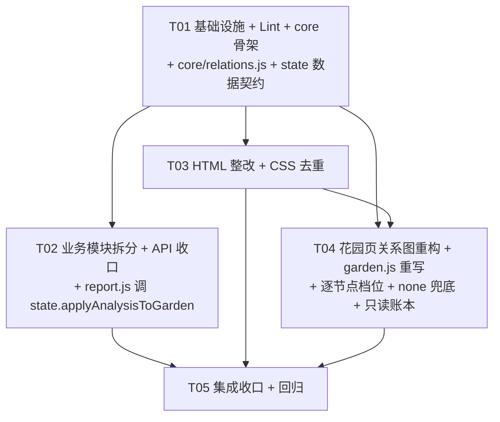

# 知间 InBetween · 花园页「关系图」语义重构 + P0 工程化整改 · 系统架构设计

> 文档类型：系统架构设计 + 任务分解（一轮交付）
> 项目根目录：`D:\AI\WorkBuddy\zhi-jian`
> 架构师：高见远（Architect）
> 版本：V1.1-garden-relationship-graph-arch
> 输入基线：`docs/design/code-baseline-for-architect.md`（齐活林实测勘察）
> 产品输入：`docs/prd/garden-relationship-graph-prd.md`（许清楚增量 PRD）
> 规范输入：`.claude/rules/code-quality.md`、`.claude/rules/iteration-workflow.md`

---

## 0. 本轮范围与核心架构判断

### 0.1 范围（两部分合并为一轮）

| 部分 | 内容 | 来源 |
|---|---|---|
| **A · 关系图语义重构** | 花园页从「四株孤立装饰物」重构为「以自我为根的星形关系图」，内联 SVG 连接带承载关系强弱，养分驱动线宽/亮度三档 | PRD P0-1 ~ P0-10 / P1 / P2 |
| **B · P0 工程化整改** | `main.js`(1743行) 拆分多模块、消 13 处 `var`、消 4 个 `window` 全局、消 6 处内联 `onclick`、修 login-screen 标签闭合、CSS 去重、ESLint+Prettier+Vitest、统一 `validateConversation()`、修 `buildUserPrompt` A/B 矛盾、`vite.config.js` 用 `loadEnv` + try/catch | 勘察报告 + 任务说明 |

### 0.2 核心架构判断（已确定，本设计在此基础上展开）

> **`main.js` 模块拆分与花园页重构必须合并为一轮。**

**理由**：花园页重构将重写 `main.js` 第 1264–1742 行（整个花园模块），而模块拆分正是把这段代码搬进 `modules/garden.js`。若分两轮：先「搬迁」一次，再「重写」一次，**同一段代码改两遍**，且搬迁后的临时版本毫无价值。
**合并后**：直接按新设计写入 `modules/garden.js`，只改一次，省一轮全量回归。

**推论**：任务分解中，**拆分与重构不是两个任务，而是同一个任务的两面**——新增文件按「先立骨架（core）→ 再落各模块（含 garden 重写）→ 最后删旧单文件」的顺序推进。

---

## Part A · 系统设计

## 1. 实现方案与框架选型

### 1.1 技术栈（锁定，零运行时依赖）

| 层 | 选型 | 约束出处 |
|---|---|---|
| 构建 | **Vite 6** | code-quality.md §1 |
| 前端 | **HTML + CSS + 原生 JS ES module** | code-quality.md §1 |
| 后端 | Vercel Serverless Function | code-quality.md §1 |
| AI | DeepSeek API | code-quality.md §1 |

**禁止**：任何前端框架（React/Vue/Svelte）、任何 CSS 框架（Tailwind/Bootstrap/MUI）、任何 JS 绘图库（D3/Chart.js/ECharts）、任何 CDN/追踪脚本。
→ **关系星图必须用内联 SVG 手写**，不得引 D3。

### 1.2 核心难点与技术方案

#### 难点 1：关系星图如何响应式映射 DOM 锚点到 SVG

**方案**：内联 SVG + `viewBox="0 0 100 100"` + `preserveAspectRatio="none"`，**百分比 → SVG 用户单位 1:1 映射**（`viewBox` 宽高各 100，即 1 用户单位 = 1% 容器尺寸）。

三个关键技术点：
1. **`preserveAspectRatio="none"`**：让 SVG 填满容器（会被非等比拉伸），但——
2. **`vector-effect="non-scaling-stroke"`**：让描边宽度**不受缩放影响**，仍以 CSS 像素渲染 → 保证 PRD 要求的 `1.5 / 3 / 5px` 是真实像素，不会因容器拉伸而变粗变细。**这是本方案成立的基石**。
3. **锚点动态换算**：不硬编码坐标。运行时用 `el.getBoundingClientRect()` 与 `scene.getBoundingClientRect()` 求**相对百分比**：

```js
// 锚点换算：把 DOM 元素中心转成相对 garden-scene 的百分比（0-100）
function anchorOf(el, sceneRect) {
  const r = el.getBoundingClientRect();
  return {
    x: ((r.left + r.width / 2 - sceneRect.left) / sceneRect.width) * 100,
    y: ((r.top + r.height / 2 - sceneRect.top) / sceneRect.height) * 100,
  };
}
```

> 为什么用 `getBoundingClientRect` 而非硬编码 PRD 的近似 %：锚点随 `.garden-fore` / `.garden-midlayer` 的 `bottom/left` 百分比与响应式媒体查询变化，**唯一可靠的锚点来源是 DOM 自身**。PRD 6.2 表的坐标仅作缺省回退值（DOM 查询失败时使用）。

**路径形态**：二次贝塞尔 `Q`（轻微下垂），中式「垂柳/山径」感。控制点用两端点中点 + 垂直偏移：

```js
// 生成一条轻微下垂的二次贝塞尔路径（Q），避免机械直线
function bandPath(a, b) {
  const cx = (a.x + b.x) / 2;
  const cy = (a.y + b.y) / 2 + Math.abs(b.x - a.x) * 0.12; // 下垂量随水平跨度增长
  return `M ${a.x} ${a.y} Q ${cx} ${cy} ${b.x} ${b.y}`;
}
```

#### 难点 2：流动光点（P0-4）如何零 JS 库实现

**方案**：`stroke-dasharray` + `stroke-dashoffset` 纯 CSS `@keyframes` 动画。
- 主带（`.band-line`）承载线宽与透明度。
- 光点层（`.band-spark`）为叠加 `<path>`，`stroke-dasharray: 2 98`（短划 + 长隔），动画 `stroke-dashoffset` 从 0 → -100（一个 dasharray 周期），`3s linear infinite`。
- 仅当连接带 class 含 `band--thick` / `band--full` 时，光点层 `opacity: 1`，否则 `0`（保留元素，靠 opacity 切换，避免 DOM 增删抖动）。

#### 难点 3：养分变化 → 连接带三档切换的平滑过渡（P0-2 / P0-3）

**方案**：状态用 **class 切换**（`.band--thin/mid/thick/full`），过渡用 **CSS `transition`**，**JS 绝不逐帧改样式**。

```css
.band-line { transition: stroke-width .8s cubic-bezier(.4,0,.2,1), opacity .8s cubic-bezier(.4,0,.2,1); }
```

档位判定与 class 施加：

```js
// 养分总量 → 档位（PRD 4.3）
export function nurtureTier(total) {
  if (total >= 100) return 'full';
  if (total >= 67) return 'thick';
  if (total >= 34) return 'mid';
  return 'thin';
}
```

#### 难点 4：`core/dom.js` 惰性查询（解决「依赖 ES module defer 语义」的脆弱性）

**现状问题**（勘察报告 §三关键脆弱点）：`main.js:124-138` 的 `dom` 对象与 `1663` 的 IIFE 在**模块顶层立即执行 `document.querySelector`**，只因 `index.html:407` 用了 `<script type="module">`（自带 defer）才侥幸工作。一旦脚本移入 `<head>` 或改为非 module，**全站静默崩溃**。

**方案**：`core/dom.js` 导出**查询函数**而非**查询结果对象**。三个层次：

```js
// core/dom.js —— 惰性 DOM 查询层
// 设计要点：导出「函数」不是「结果」，杜绝模块顶层立即查询。

/** 单元素查询（惰性，调用时才查） */
export const $ = (sel, root = document) => root.querySelector(sel);

/** 多元素查询（返回数组，便于 forEach/map） */
export const $$ = (sel, root = document) => Array.from(root.querySelectorAll(sel));

/**
 * 按 id 查询（惰性 + 空值容错）
 * 用法：const el = byId('garden-screen'); if (el) { ... }
 */
export const byId = (id) => document.getElementById(id);

/**
 * 批量取元素对象（惰性 getter，避免顶层立即查询）
 * 返回的对象每个属性是 getter：访问 dom.textInput 时才执行查询。
 */
export function lazyDom(map) {
  const out = {};
  for (const [key, sel] of Object.entries(map)) {
    Object.defineProperty(out, key, {
      get: () => $(sel),
      enumerable: true,
    });
  }
  return out;
}
```

**各模块统一用法**：
- 事件绑定一律放在模块导出的 `initXxx()` 里，由 `main.js` 在 **DOMContentLoaded 之后** 调用（同时保留 module defer 语义下的直接调用能力）。
- 需要频繁访问的元素，在 `initXxx()` 内用 `const el = byId('...')` **一次性取到局部常量**，函数作用域内复用——既是惰性查询（init 时才查），又有缓存效果，且**不产生模块级 DOM 引用**。

```js
// 示例：modules/garden.js 内
export function initGarden() {
  const scene = byId('garden-scene');     // init 时才查，安全
  if (!scene) return;                      // 空值容错
  // ... 后续全部用局部常量
}
```

> **`main.js` 职责**：`import` 各模块 → 在 `DOMContentLoaded` 回调里顺序调用 `initWelcome/initInput/initReport/initSpace/initGarden`。`main.js` 自身**不持有任何模块级 DOM 引用**。

#### 难点 5：统一路由（消灭 6 处内联 onclick）

**方案**：新增 `core/router.js`，导出 `goTo(screenId)`；HTML 用 `data-goto="xxx"` 属性，JS 在 `document` 上做**事件委托**。

```js
// core/router.js —— 统一路由
const SCREEN_IDS = ['intro-screen','space-screen','account-screen','login-screen',
                    'garden-screen','input-screen','loading-screen','report-screen'];

// body 样式映射表：解决「谁是 active」与「body 背景/文字色」的双重耦合
const BODY_STYLE = {
  'intro-screen':  { bg: '#101827', color: '#F3EFE7' },  // Night 夜空
  'space-screen':  { bg: '#F3EFE7', color: '#343434' },  // Paper 纸
  'account-screen':{ bg: '#F3EFE7', color: '#343434' },
  'login-screen':  { bg: '#F3EFE7', color: '#343434' },
  'garden-screen': { bg: '#F3E3C1', color: '#343434' },  // Sunrise 黎明
  'input-screen':  { bg: '#F8F6F2', color: '#2B2B2B' },
  'loading-screen':{ bg: '#F8F6F2', color: '#2B2B2B' },
  'report-screen': { bg: '#F8F6F2', color: '#2B2B2B' },
};

export function goTo(screenId) {
  if (!SCREEN_IDS.includes(screenId)) return;
  SCREEN_IDS.forEach((id) => byId(id)?.classList.toggle('active', id === screenId));
  const s = BODY_STYLE[screenId];
  if (s) { document.body.style.background = s.bg; document.body.style.color = s.color; }
  window.scrollTo({ top: 0 });
  document.dispatchEvent(new CustomEvent('navigate', { detail: { screenId } }));
}

/** 全局点击委托：任何 [data-goto] 元素被点击 → goTo */
export function initRouter() {
  document.addEventListener('click', (e) => {
    const t = e.target.closest('[data-goto]');
    if (t) goTo(t.dataset.goto);
  });
}
```

> `navigate` 事件的用途：`initGardenCanvas()` 需要在进入花园页时启动粒子动画——改为监听 `navigate` 事件，而不是在按钮回调里硬编码调用（解耦）。

### 1.3 架构模式

**分层 + 单向依赖**：

```
main.js (编排层)
   ↓ import（只 downward）
core/     ← 基础能力（无业务，不 import modules）
   ↑ import
modules/  ← 业务模块（可 import core，模块间原则上不互相 import）
```

- **core 层**：`state.js`（全局状态）、`dom.js`（惰性查询）、`router.js`（路由）、`utils.js`（`escapeHtml`/`showToast`）。core 之间可互相 import（`router.js` 用 `dom.js`），但 **core 绝不 import modules**。
- **modules 层**：每个业务模块导出 `initXxx()`（绑定事件）+ 若干具名函数。**modules 之间不互相 import**（需要跳转时用 `goTo()`，需要状态时从 `core/state.js` 取）。**唯一例外**：`modules/report.js` 的「开始新的分析」按钮跳回花园——通过 `goTo('garden-screen')` + `navigate` 事件实现，**不 import garden**。
- **消除循环依赖**：靠「跳转统一走 router、数据统一走 state」两条纪律，模块间零直接 import。

---

## 2. 完整文件列表及相对路径

```
D:\AI\WorkBuddy\zhi-jian\
├── index.html                       # [改] 删 6 处 onclick→data-goto；修 login-screen 闭合；新增 SVG 星图容器；删 .stone-lantern；加 data-anchor
├── package.json                     # [改] vite→devDeps；加 engines/private；加脚本 lint/format/test/check
├── vite.config.js                   # [改] 手写 loadEnvLocal→loadEnv；JSON.parse 加 try/catch；校验复用 validateConversation
├── eslint.config.js                 # [新] ESLint 9 flat config（见 §7）
├── .prettierrc.json                 # [新] Prettier 配置
├── .prettierignore                  # [新] 忽略 dist / public / *.md
├── .editorconfig                    # [新] 缩进/换行统一
├── vercel.json                      # [改] routes→rewrites；加 headers（安全头）
├── src/
│   ├── main.js                      # [重写] 仅 import + init 编排，目标 < 80 行
│   ├── style.css                    # [改] 去重 + 花园页新增星图样式（保持单文件，理由见 §9-U2）
│   ├── core/
│   │   ├── state.js                 # [新] 全局状态（原 113-116 行）
│   │   ├── dom.js                   # [新] 惰性 DOM 查询（原 121-138 行改造）
│   │   ├── router.js                # [新] 统一路由 goTo()（消灭 6 处 onclick）
│   │   └── utils.js                 # [新] escapeHtml / showToast / debounce（原 825-838 行）
│   └── modules/
│       ├── welcome.js               # [新] 原 9-108 行（涟漪 + goToInput 消融转场）
│       ├── input.js                 # [新] 原 143-301 行（Tab/上传/按钮态/startAnalysis）
│       ├── report.js                # [新] 原 306-970 + 1055-1262 行（报告渲染 + 分享 + 视角）
│       ├── space.js                 # [新] 原 978-1034 行（goToSpace 消融转场）
│       └── garden.js                # [新] 原 1264-1742 行 + 本次关系图重构
├── api/
│   ├── _core.js                     # [改] 新增 validateConversation()；修 buildUserPrompt A/B 矛盾
│   └── analyze.js                   # [改] 校验复用 validateConversation()；错误分级
└── tests/                           # [新] Vitest 单测（可测纯函数）
    ├── utils.test.js                # escapeHtml
    ├── garden.test.js               # nurtureTier / bandPath / getSeasonIndex / getSeasonName
    ├── report.test.js               # calcEnergyScore→calcNurtureScore / buildPartyLabelMap / partyName
    └── core.test.js                 # validateConversation / buildUserPrompt
```

> **与 code-quality.md §2 期望结构的差异说明**：规范期望 `src/` 平铺 5 文件；本设计增加 `core/` 与 `modules/` 两个子目录。
> **理由**：1743 行拆成 5 个平铺文件后，`dom` 查询、状态、路由、utils 会成为「每个模块都要 import 的散装横切关注点」，平铺结构无法表达依赖方向。加一层目录后，`core`（无业务、被依赖）与 `modules`（有业务、依赖 core）的**依赖方向在文件树上一眼可见**，这正是消除循环依赖的关键。
> 若团队坚持与规范字面一致，可退化为平铺（`state.js`/`dom.js`/`router.js`/`utils.js` 直接放 `src/`），**函数接口完全不变**——本设计对文件位置做了低耦合处理。

---

## 3. 数据结构与模块接口定义

### 3.1 核心数据结构（classDiagram）

见 `docs/class-diagram.mermaid`。关键结构文字说明如下。

#### 3.1.1 全局状态（`core/state.js`）

```js
export const state = {
  conversation: '',        // 待分析的对话原文
  inputMode: 'paste',      // 'paste' | 'audio' | 'image'
  currentViewParty: null,  // 报告页当前视角的参与方（原 main.js:1055 var）
  shareAnalysisRef: null,  // 分享用分析结果引用（原 762 var）
  shareBound: false,       // 分享逻辑是否已绑定（原 763 var）
  lastClickX: 0,           // 涟漪点击坐标（原 9 var）
  lastClickY: 0,           // 涟漪点击坐标（原 10 var）
};
```

#### 3.1.2 关系图数据结构（`modules/garden.js`）

```js
/**
 * 角色节点定义
 * @typedef {Object} RoleNode
 * @property {string} id        'self' | 'family' | 'partner' | 'friend'
 * @property {string} label     '自我 · 新芽' / '家人 · 古树' / '伴侣 · 花' / '朋友 · 小动物'
 * @property {string} elId      对应 DOM 元素 id（'eco-seedling' / 'eco-tree' / 'eco-flower' / 'animal-zone'）
 * @property {string} anchorKey data-anchor 属性值（用于 getBoundingClientRect 定位）
 * @property {boolean} present  该角色是否存在于当前记录（决定是否画带）
 */

/**
 * 连接带数据
 * @typedef {Object} Band
 * @property {string} from      'self'（V1 恒为 self，星形拓扑 Q1-A）
 * @property {string} to        'family' | 'partner' | 'friend'
 * @property {number} strength  0-100 内部值（绝不上屏）
 * @property {boolean} active   近期是否有互动（决定光点）
 * @property {'up'|'steady'|'down'} trend  趋势（决定端点呼吸动效，P2）
 */

/** 角色全集（V1 固定 4 个；present 由 localStorage['zhijian-relations'] 决定） */
export const ROLE_NODES = [ /* RoleNode[]，见上 */ ];

/** 缺省锚点（DOM 查询失败时的回退，取自 PRD 6.2） */
export const FALLBACK_ANCHORS = {
  self:    { x: 20, y: 68 },
  family:  { x: 24, y: 30 },
  partner: { x: 52, y: 62 },
  friend:  { x: 74, y: 66 },
};

/** 「档位 × 季节」状态文案表（P1-5：集中一张表便于审校） */
export const STATUS_TEXT = {
  thin:  { 0:'关系在安静地沉淀', 1:'你的关系正在慢慢生长', 2:'关系正待滋养', 3:'你收获了一些理解' },
  mid:   { 0:'关系在安静地沉淀', 1:'连接在生长 · 你的关系正在慢慢生长', 2:'关系正值繁盛', 3:'你收获了一些理解' },
  thick: { 0:'关系在安静地沉淀', 1:'连接很活跃', 2:'关系正值繁盛', 3:'连接正繁盛' },
  full:  { 0:'关系在安静地沉淀', 1:'连接正繁盛', 2:'关系正值繁盛', 3:'连接正繁盛' },
};
```

#### 3.1.3 季节（复用现有常量，仅去 `var`）

```js
export const SEASONS = ['冬·沉淀季','春·生长季','夏·繁盛季','秋·收获季'];
```

### 3.2 模块导出清单（ES module 具名导出）

| 模块 | 具名导出 | 签名 | 说明 |
|---|---|---|---|
| **core/state.js** | `state` | `Object` | 全局可变状态单例 |
| **core/dom.js** | `$` | `(sel, root?) => Element\|null` | querySelector 惰性封装 |
| | `$$` | `(sel, root?) => Element[]` | querySelectorAll → 数组 |
| | `byId` | `(id) => Element\|null` | getElementById 惰性封装 |
| | `lazyDom` | `(map: Record<string,string>) => Record<string,getter>` | 惰性元素对象 |
| **core/router.js** | `goTo` | `(screenId: string) => void` | 唯一页面切换入口 |
| | `initRouter` | `() => void` | 绑定 `[data-goto]` 事件委托 |
| | `SCREEN_IDS` | `string[]` | 合法 screen id 列表 |
| **core/utils.js** | `escapeHtml` | `(s: string) => string` | 转义 `< > " ' &` |
| | `showToast` | `(msg: string, ms?: number) => void` | 轻提示 |
| | `debounce` | `(fn, wait) => Function` | 节流（resize 用） |
| **modules/welcome.js** | `initWelcome` | `() => void` | 涟漪 + intro 按钮绑定 |
| | `rippleAt` | `(x, y) => void` | 生成涟漪（原 12-39） |
| **modules/input.js** | `initInput` | `() => void` | Tab/上传/按钮事件绑定 |
| | `updateAnalyzeButton` | `() => void` | 分析按钮可用态 |
| | `startAnalysis` | `() => Promise<void>` | 调 API + 跳 loading |
| **modules/report.js** | `initReport` | `() => void` | 分享/视角/新分析按钮绑定 |
| | `renderReport` | `(analysis) => void` | 报告总编排 |
| | `calcNurtureScore` | `(items) => number` | **原 `calcEnergyScore` 更名**（术语合规） |
| | `buildPartyLabelMap` | `(parties) => Map` | 参与方标签映射 |
| | `partyName` | `(map, id) => string` | 取参与方名 |
| | `handleSharedLink` | `() => boolean` | 处理 ?share= 参数 |
| | `renderSharedView` | `(payload) => void` | 分享视图渲染 |
| **modules/space.js** | `initSpace` | `() => void` | 空间页消融转场绑定 |
| | `goToSpaceTransition` | `() => void` | 原 `window.goToSpace` 转有序导出 |
| **modules/garden.js** | `initGarden` | `() => void` | 花园入口（含星图 init） |
| | `initGardenCanvas` | `() => void` | 粒子动画（原 1545-1606） |
| | `getNurture` | `() => number` | 读 localStorage |
| | `addNurture` | `(n: number) => void` | 加养分 + 刷新 UI + 刷新带 |
| | `updateNurtureUI` | `() => void` | 数字 + 状态文案 |
| | `updateRelationshipBands` | `() => void` | **新增**：重算锚点 + 施加档位 class |
| | `nurtureTier` | `(total: number) => 'thin'\|'mid'\|'thick'\|'full'` | **纯函数**，可单测 |
| | `bandPath` | `(a, b) => string` | **纯函数**，生成 Q 路径 |
| | `getSeasonIndex` | `() => number` | 纯函数 |
| | `getSeasonName` | `() => string` | 纯函数 |
| | `renderRelationGraph` | `() => void` | 按 present 角色生成/更新 `<path>` |
| | `waterCreature` | `(elId: string) => void` | **原 `window.waterCreature` 转具名导出** |
| | `waterGarden` | `() => void` | **原 `window.waterGarden` 转具名导出** |
| **api/_core.js** | `validateConversation` | `(conversation: string) => {ok: boolean, reason?: string}` | **新增**，统一口径 |
| | `buildUserPrompt` | `(conversation, userRole) => string` | **修**：不再返回 'A'/'B' |
| | `runAnalysis` | `(conversation, userRole, apiKey) => Promise` | 不变 |
| | `SYSTEM_PROMPT` / `BALANCE_CHECK_PROMPT` | `string` | 不变 |

### 3.3 `goTo(screenId)` 与 body 样式映射表

见 §1.2 难点 5 的 `BODY_STYLE` 常量。**映射表要点**：把「哪个 screen 是 active」与「body 背景/文字色」**绑定成一张表**——这两件事在原代码里是分裂的（174/198 行手工改 classList + 手工设 body 样式，极易漏改）。统一后，**新增页面只需在表里加一行**。

**`prefers-reduced-motion` 处理**：`goTo` 触发的 CSS 过渡在 `@media (prefers-reduced-motion: reduce)` 下关闭（见 §8 共享知识）。

---

## 4. 程序调用流程

见 `docs/sequence-diagram.mermaid`。核心三条流程如下。

### 4.1 页面切换流程（消除 onclick 后的新范式）



### 4.2 花园页初始化流程



### 4.3 养分变化 → 连接带更新流程



---

## Part B · 任务分解

## 5. 任务列表（按依赖顺序，硬上限 5 条）

> 粒度遵循 `iteration-workflow.md` 小步精神，但按「功能模块/层次」分组批量处理（每条含 ≥3 文件），避免单文件一任务。
> **共 5 条任务**（T01 基础设施 → T05 集成收口），其中 **T04 是本轮核心**（花园页重构，因合并判断而与模块拆分融为一体）。

### T01 · 项目基础设施 + Lint 工具链 + 核心层骨架

- **依赖**：无（起点）
- **优先级**：P0
- **涉及文件**：
  - `package.json`（vite→devDependencies；加 engines>=20 / private:true；脚本 `dev/build/preview/lint/format/test/check`）
  - `eslint.config.js`（新建，见 §7）
  - `.prettierrc.json` / `.prettierignore` / `.editorconfig`（新建）
  - `tests/`（新建目录 + `tests/core.test.js` 占位）
  - `src/core/state.js`（新建）
  - `src/core/dom.js`（新建，惰性查询）
  - `src/core/router.js`（新建，`goTo` + `initRouter`）
  - `src/core/utils.js`（新建，`escapeHtml`/`showToast`/`debounce`）
- **核心动作**：
  1. `package.json` 整改：`dependencies` 清空，`vite` 移入 `devDependencies`；devDeps 加 `eslint`/`prettier`/`vitest`（版本见 §6）；`engines.node: ">=20"`；`private: true`；`version: "0.1.0"`；脚本 `"check": "npm run lint && npm run test"`。
  2. 写 `eslint.config.js`（ESLint 9 flat config，`no-var` / 禁 `window.*` / 禁 `innerHTML=` / `no-eval` / `prefer-const`）。
  3. 建 `core/` 四个文件（从原 `main.js` 抽出 `state`/`dom`/`utils`，新增 `router`）。
- **验收标准**：
  - `npm install` 成功；`npm run lint` 在空 core 文件上 **0 error 0 warning**。
  - `npm run test` 可运行（占位测试通过）。
  - `core/dom.js` 中**不存在**任何模块顶层 `document.querySelector` 调用（`grep` 验证：文件内 `querySelector` 仅出现在函数体内）。
  - `core/router.js` 的 `goTo('garden-screen')` 手动在浏览器 console 调用可切换页面。

### T02 · 业务模块拆分（welcome / input / space / report）

- **依赖**：T01
- **优先级**：P0
- **涉及文件**：
  - `src/modules/welcome.js`（原 9-108 行）
  - `src/modules/input.js`（原 143-301 行）
  - `src/modules/space.js`（原 978-1034 行）
  - `src/modules/report.js`（原 306-970 + 1055-1262 行）
  - `src/main.js`（**首次改写**：改为纯 import + init 编排，暂不删旧内容 → 本轮先建新入口骨架）
  - `api/_core.js`（**并列推进**：新增 `validateConversation()`；修 `buildUserPrompt` A/B 矛盾）
  - `api/analyze.js`（校验复用 `validateConversation()`）
  - `vite.config.js`（校验复用 `validateConversation()`；`loadEnv` 替换手写解析；`JSON.parse` 加 try/catch）
- **核心动作**：
  1. 把 4 个模块**原样搬迁**（仅做三件事：去 `var`→`const/let`、`window.xxx`→具名导出、顶层立即查询→`initXxx()` 内查询）。
  2. `calcEnergyScore` **更名为 `calcNurtureScore`**（术语合规），更新所有调用点。
  3. `api/_core.js` 新增 `validateConversation`（口径：`≥3 行有意义对话`，与 QA-LOG 声称一致），`analyze.js` 与 `vite.config.js` 两处均改调用它。
  4. `buildUserPrompt`：删除 `'A'/'B'` 分支，改为 `userRole ? \`用户标注自己的身份为：${userRole}\` : '用户未标注身份，请根据对话内容自动判断'`。
  5. `vite.config.js`：`import { loadEnv } from 'vite'` 替换 `loadEnvLocal()`；`JSON.parse(body)` 包 try/catch → 返回 400。
- **验收标准**：
  - 拆分后**四屏流程（Welcome→输入→报告→花园）可完整走通**（浏览器手测）。
  - `npm run lint` **0 error**（旧 `var`/`window.*` 已清零）。
  - 单测（`tests/core.test.js`）覆盖 `validateConversation`（空 / `<3` 行 / `≥3` 行）与 `buildUserPrompt`（未标注身份时**不含**「身份为：A」）→ 全绿。
  - `api/analyze.js:27` 与 `vite.config.js` 的校验**均调用 `validateConversation`**（`grep` 验证不再有 `length < 20`）。

### T03 · HTML 结构整改 + CSS 去重（不含花园星图）

- **依赖**：T01（路由就绪）
- **优先级**：P0
- **涉及文件**：
  - `index.html`（删 6 处内联 `onclick` → `data-goto`；修 login-screen 205-226 标签闭合；导航按钮加 `data-goto`/`data-toast`）
  - `src/style.css`（① 合并 `#garden-screen` 382/518 两处定义 → 保留 518 语义；② 合并 `#gardenCanvas` 381/542 → 保留 542；③ 删 `.force-refresh{}` 空规则与 `.halo` 残骸；④ `:root` 的 `--warm-card:#fff` → 合规色值；⑤ **此任务先不动花园页星图部分**）
  - `src/modules/welcome.js` / `space.js` / `report.js`（把原被 `onclick` 调用的行为，改由 `data-goto` + router 承接；`window.goToInput`/`window.goToSpace` 的调用点同步删除）
- **核心动作**：
  1. index.html：
     - 105/106 行：`onclick="window.goToInput(event)"` → `data-goto="input-screen"`；`onclick="window.goToSpace(event)"` → `data-goto="space-screen"`。
     - 174/198 行 `.btn-signup` → `data-goto="account-screen"` / `data-goto="garden-screen"`。
     - 175/199 行 `.signup-link a` → `data-goto="login-screen"`。
     - 205-226 行补上缺失的 `</div>`，使 `.account-container`(206) 与 `.account-form`(211) 正确闭合。
     - 底部导航 `nav-record`/`nav-me` 的 `📋 记录 · 即将上线` / `👤 我的` 改为 `data-toast="..."`，由 router 的委托统一处理（**顺手消除 garden.js 内联中文提示耦合**）。
  2. style.css 去重 + 清残骸（保留所有花园页**布局**规则，仅删重复/空/残骸；星图新增样式留给 T04）。
  3. 各模块删除对 `window.goToInput`/`window.goToSpace` 的依赖，改签名（保留函数但不再挂 window）。
- **验收标准**：
  - `index.html` **零 `onclick`**（`grep -c 'onclick' index.html` = 0）。
  - login-screen 的 DOM 树正确：浏览器 DevTools 里 `#login-screen` 的 direct children 只有 `.account-container`。
  - `grep` 确认 `style.css` 中 `#garden-screen` 仅 1 处、`#gardenCanvas` 仅 1 处，无 `.force-refresh`/`.halo`。
  - 所有页面切换（含空间页/账号页/登录页）走 `data-goto` 正常。
  - 浏览器 console **无报错**。

### T04 · 花园页「关系图」语义重构 + `modules/garden.js` 重写【本轮核心】

- **依赖**：T01（core 就绪）、T03（index.html 花园结构 + CSS 去重完成）
- **优先级**：P0
- **涉及文件**：
  - `src/modules/garden.js`（**全新编写**——按新设计直接落笔，不再「先搬迁后重写」；含原 1264-1742 全部逻辑 + 星图）
  - `index.html`（花园页 L229-331：删 `.stone-lantern`；新增 `<svg class="relation-graph">`；近景三元素按 PRD 6.3 重排；各角色节点加 `data-anchor`；emoji `🎐` 处理）
  - `src/style.css`（花园页新增：`.relation-graph` / `.band--thin|mid|thick|full` / 光点 `@keyframes` / `.garden-bg` height 65%→58% / `.tree-crowns` top -75→-58 / 锚点重排 / 节点可点击态）
  - `tests/garden.test.js`（新建：`nurtureTier` 边界值 0/33/34/66/67/99/100；`bandPath` 输出格式；`getSeasonIndex`/`getSeasonName`）
- **核心动作**：
  1. **删除 `.stone-lantern`**（P0-5：纯装饰、无语义）。
  2. **新增星图层**：`<svg class="relation-graph" viewBox="0 0 100 100" preserveAspectRatio="none">`，内部 `pointer-events:none`（hover 由节点承担，P1-3 的带 hover 用 `stroke` 命中区放大 8px 的独立透明 `<path>`）。
  3. **锚点体系**：角色节点加 `data-anchor="self|family|partner|friend"`；`anchorOf()` 用 `getBoundingClientRect` 动态换算；`FALLBACK_ANCHORS` 兜底。
  4. **连接带渲染**：`renderRelationGraph()` 按 `present` 角色增删/更新 `<path class="band-line">` + `<path class="band-spark">`；路径用 `bandPath()` 二次贝塞尔。
  5. **档位驱动**：`nurtureTier(0-33/34-66/67-100/≥100)` → class `band--thin/mid/thick/full`；CSS `transition: stroke-width .8s, opacity .8s`（P0-2/P0-3）；光点仅 thick/full 显示（P0-4）。
  6. **`updateNurtureUI()` 内追加 `updateRelationshipBands()`**（PRD §8 落点）；`addNurture` 完成后自动刷新带。
  7. **`waterGarden` / `waterCreature` 转具名导出**，删除 `window.*` 挂载；调用点改为模块内直接调用。
  8. **连接带点击（Q5-A）**：`showToast('查看与「伴侣」的关系回顾 · 即将上线')` 占位。
  9. **季节氛围（P1-2）**：`getSeasonIndex` / `getSeasonName` 驱动带主色 + 状态文案；文案取自 `STATUS_TEXT[档位][季节]`。
  10. **响应式**：`@media(max-width:480px)` 动物区 `flex-wrap:wrap` 2×2 网格；`safe-area-inset-*` 补齐；触控 ≥44px（P0-9）。
  11. 单测 `tests/garden.test.js` 覆盖全部纯函数。
- **验收标准**（对应 PRD P0）：
  - P0-1：`<svg class="relation-graph">` 存在，含 1–3 条 `<path class="band-line">` 从自我锚点连向各角色，**无外部资源引用**。
  - P0-2：手动设 `localStorage['zhijian-nurture']` = 10/50/80 → `stroke-width` 分别为 1.5/3/5px，透明度 0.28/0.55/0.85（DevTools 验）。
  - P0-3：CSS 含 `transition: stroke-width .8s`；增养分后**肉眼可见渐变**（截图对比）。
  - P0-4：养分 ≥67 时带上有 `stroke-dasharray` 流动动画，`3s` 循环。
  - P0-5：`grep 'stone-lantern' index.html src/style.css` = 0。
  - P0-6：角色节点（树/花/动物/新芽）**无 emoji**；`🌱` 养分图标换单色 SVG；`🎐` 风铃删除或换 SVG（P0 角色层，导航图标 SVG 列 P1）。
  - P0-7：320/375/414px 下花丛/动物区/新芽**视觉不重叠**（截图）。
  - P0-8：`.tree-crowns` 顶不超出 `.garden-midlayer`（DevTools 量 rect）。
  - P0-9：320px 无横向滚动；触控 ≥44px；正文 ≥16px；含 `safe-area-inset`。
  - P0-10：页面无「关系能量/关系分数/数据看板」；无维度分数；术语合规。
  - `npm run test` 全绿；`npm run lint` 0 error。

### T05 · 集成收口（入口编排 / 回归 / 文档）

- **依赖**：T02、T03、T04
- **优先级**：P0
- **涉及文件**：
  - `src/main.js`（**最终定稿**：纯 import + `DOMContentLoaded` 编排，< 80 行；删除所有旧的残留单文件内容）
  - `tests/`（补齐 `utils.test.js` / `report.test.js`）
  - `vercel.json`（`routes`→`rewrites`；加 `headers` 安全头）
  - `.github/workflows/deploy.yml`（加 `npm run check` 质量门禁步骤）
  - `docs/` （更新 QA-LOG 或交付说明——**只改可信实测项**）
- **核心动作**：
  1. `main.js` 定稿：`import` 全部 core + modules；`document.addEventListener('DOMContentLoaded', () => { initRouter(); initWelcome(); initInput(); initReport(); initSpace(); initGarden(); })`；监听 `navigate` 事件驱动花园 canvas。
  2. 补齐单测：`escapeHtml`（`< > " ' &`）、`calcNurtureScore`（空/单元素/全零）、`buildPartyLabelMap`（2-5 人）、`partyName`。
  3. `vercel.json`：`rewrites` 替代 `routes`；加 `X-Content-Type-Options` / `X-Frame-Options` / `Referrer-Policy`。
  4. CI 加 `npm ci && npm run check && npm run build` 门禁（原 CI 零门禁）。
  5. 全流程回归：Welcome→空间→账号→登录→输入→loading→报告→花园→再回花园，逐屏截图。
- **验收标准**：
  - `src/main.js` < 80 行，**不含任何业务逻辑**（只有 import 与 init 调用）。
  - 项目内 `grep`：`var ` 声明 = 0；`window.` 业务挂载 = 0；`onclick` = 0。
  - `npm run check`（lint + test）**全绿**；`npm run build` 成功。
  - **端到端手测**：8 屏全流程无 console 报错，花园页关系带随养分三档可见变化。
  - 部署预览（Vercel）可访问，`/api/analyze` 正常。

### 5.1 任务依赖图



**并行建议**：T02 与 T03 可并行（均只依赖 T01，文件不冲突——T02 动 `src/modules/*` 与 `api/*`，T03 动 `index.html` 与 `src/style.css` 非花园段）。
**串行必须**：T04 依赖 T03（花园 HTML/CSS 就绪）；T05 必须最后。

---

## 6. 依赖包列表（精确版本 + 零 runtime 依赖）

### 6.1 `devDependencies`

```json
{
  "devDependencies": {
    "eslint": "^9.13.0",
    "prettier": "^3.3.3",
    "vitest": "^2.1.4",
    "vite": "^6.0.0"
  },
  "dependencies": {},
  "engines": { "node": ">=20" },
  "private": true
}
```

> **`vite` 从 `dependencies` 移入 `devDependencies`**：Vite 是构建工具，不是运行时依赖；原位置是错的。

### 6.2 是否需要 `eslint-plugin-*` / `stylelint`

| 候选 | 决策 | 理由 |
|---|---|---|
| `eslint-plugin-html` | ❌ **不引入** | 内联 `onclick` 检测**不用 ESLint**——用 npm script 里的**独立 grep 脚本**（见 §7.4），更简单、零依赖、更可靠。 |
| `eslint-plugin-import` | ❌ 不引入 | 模块依赖方向靠「core 不 import modules」的人工纪律 + 代码评审，不引插件。 |
| `stylelint` | ⚠️ **本轮不引入**（列为待明确 U1） | 8 处 `!important`、14 处 ID 选择器、21 处禁用色值确实需要机器校验；但 CSS 规范校验会引入配置复杂度与大量存量告警，**建议下一轮单独做**。本轮用代码评审 + grep 脚本兜底（§7.5）。 |
| `@eslint/js` | ✅ **需要** | ESLint 9 flat config 的 `js.configs.recommended` 来源，是 ESLint 官方包，随 ESLint 一并安装。 |

### 6.3 零 runtime 依赖确认

`dependencies` **必须为空对象**。校验：CI 产物 `dist/` 中无任何第三方 JS（`grep` 检查无 `node_modules` 引用）。

---

## 7. ESLint 配置方案

### 7.1 禁令 → 规则映射表

| code-quality.md 禁令 | 实测违规 | ESLint 规则 | 说明 |
|---|---|---|---|
| 禁止 `var` | 13 处 | `no-var: error` | 强制 `const/let` |
| 禁止全局变量 | 4 个 window 挂载 | `no-implicit-globals` + `no-restricted-syntax`（禁 `window.xxx =`） | 见 §7.2 |
| 禁止 `innerHTML =` 直接赋值 | 18 处 | `no-restricted-syntax`（自定义选择器） | 见 §7.2 |
| 禁止 `eval` | — | `no-eval: error` + `no-implied-eval: error` | |
| 优先 `const` | — | `prefer-const: error` | |
| `'use strict'` / ES module | — | ES module 天然严格模式；`sourceType: 'module'` | |
| 禁止 `document.write` | — | `no-restricted-globals` / `no-restricted-properties` | |
| 禁止轮询 `setInterval` 检查状态 | — | `no-restricted-syntax`（限制 `setInterval`，见 §7.2） | 允许动画用 `setInterval` 先降为 warn |
| 内联 `onclick`（HTML） | 6 处 | ❌ ESLint 管不了 HTML → **独立 grep 脚本**（§7.4） | |

### 7.2 可直接使用的 `eslint.config.js`（ESLint 9 flat config）

```js
// eslint.config.js —— ESLint 9 flat config
// 目标：把 .claude/rules/code-quality.md 的禁令翻译成可执行规则
import js from '@eslint/js';

export default [
  // 忽略生成产物与第三方
  { ignores: ['dist/**', 'node_modules/**', 'public/**', '.claude/**', 'docs/**'] },

  // 全局推荐规则
  js.configs.recommended,

  // 主配置：源码与测试
  {
    files: ['**/*.js'],
    languageOptions: {
      ecmaVersion: 2023,
      sourceType: 'module',
      globals: {
        // 浏览器全局（不用 globals 包，手写最小集合，保持零额外依赖）
        window: 'readonly',
        document: 'readonly',
        localStorage: 'readonly',
        console: 'readonly',
        fetch: 'readonly',
        setTimeout: 'readonly',
        clearTimeout: 'readonly',
        setInterval: 'readonly',
        clearInterval: 'readonly',
        requestAnimationFrame: 'readonly',
        cancelAnimationFrame: 'readonly',
        CustomEvent: 'readonly',
        AbortController: 'readonly',
        URL: 'readonly',
        navigator: 'readonly',
        getComputedStyle: 'readonly',
      },
    },
    rules: {
      // —— 变量声明 ——
      'no-var': 'error',              // code-quality §5（13 处违规）
      'prefer-const': 'error',        // code-quality §5
      'no-implicit-globals': 'error', // code-quality §5 禁止全局变量

      // —— 禁止危险 API ——
      'no-eval': 'error',             // code-quality §10
      'no-implied-eval': 'error',
      'no-new-func': 'error',

      // —— 禁止挂载 window 全局（4 处违规）——
      // 允许读取 window.scrollTo 等，但禁止 window.xxx = ...
      'no-restricted-properties': [
        'error',
        { object: 'window', property: 'eval', message: '禁止 eval（code-quality §10）' },
      ],
      'no-restricted-syntax': [
        'error',
        {
          // 禁止 window.xxx = ...（全局挂载）
          selector: "AssignmentExpression[left.object.name='window']",
          message: '禁止挂载 window 全局（code-quality §5）。请用 ES module 具名导出 + addEventListener。',
        },
        {
          // 禁止 innerHTML = 直接赋值（18 处违规）
          selector: "AssignmentExpression[left.property.name='innerHTML']",
          message: '禁止 innerHTML= 直接赋值（code-quality §10）。请用 textContent，或用 escapeHtml() 拼装后经 document.createElement + append 构建。',
        },
        {
          // 禁止 outerHTML / insertAdjacentHTML
          selector: "AssignmentExpression[left.property.name='outerHTML']",
          message: '禁止 outerHTML= 赋值，请用 DOM API 构建。',
        },
        {
          selector: "CallExpression[callee.property.name='insertAdjacentHTML']",
          message: '禁止 insertAdjacentHTML，请用 createElement/append。',
        },
        {
          // 禁止 document.write
          selector: "CallExpression[callee.object.name='document'][callee.property.name='write']",
          message: '禁止 document.write（code-quality §10）。',
        },
        {
          // 禁止 .then().catch() 链式（要求 async/await）
          selector: "CallExpression[callee.property.name='catch'][callee.object.callee.property.name='then']",
          message: '禁止 fetch().then().catch()（code-quality §10）。请用 async/await + try/catch。',
        },
      ],

      // —— 其他质量规则（与规范精神一致）——
      'eqeqeq': ['error', 'always', { null: 'ignore' }],
      'no-unused-vars': ['error', { argsIgnorePattern: '^_', varsIgnorePattern: '^_' }],
      'no-console': 'off', // 允许 console.error 用于错误上报（code-quality §6 示例中即用 console.error）

      // —— 异步规范（code-quality §5）——
      'require-await': 'warn', // async 函数应有 await
      'no-await-in-loop': 'warn',
    },
  },

  // 测试文件：放宽
  {
    files: ['tests/**/*.js', '**/*.test.js'],
    rules: {
      'no-unused-expressions': 'off',
    },
  },
];
```

### 7.3 关于 `innerHTML` 的特殊说明

18 处 `innerHTML` 全部禁止会**阻塞重构**（报告页大量用 innerHTML 拼 HTML）。**分两步走**：
1. **本轮**：规则设为 `error`，但**允许经 `escapeHtml()` 包裹后赋值**——ESLint 无法识别「变量是否已转义」，因此工程上采用**约定 + 评审**：
   - 任何 `innerHTML =` 赋值，**右值必须来自 `buildXxxHTML()` 函数**，且该函数内所有插值均经 `escapeHtml()`。
   - 更严格的可选做法：本轮先设 `'warn'`，在 §8 共享知识里写死「innerHTML 只能由 `buildXxxHTML` 产出」的纪律，**T05 收口时升级为 `error`**。
2. **建议**：T01 建成 `error`，若 T02 搬迁时遇阻断，由工程师在 PR 说明后临时降 `warn`，T05 恢复 `error`。

> ⚠️ 这 18 处是**存量技术债**，本轮目标不是全清（会拖垮进度），而是**建立规则并止血**——新增代码不得再引入 `innerHTML=`。存量已转义的可保留。

### 7.4 内联 `onclick` 检测脚本（替代 `eslint-plugin-html`）

在 `package.json` 脚本里加：

```json
{
  "scripts": {
    "lint:html": "node scripts/check-html.mjs",
    "lint": "eslint . && npm run lint:html",
    "format": "prettier --write .",
    "test": "vitest run",
    "check": "npm run lint && npm run test"
  }
}
```

`scripts/check-html.mjs`（零依赖，用 Node 内置 `fs`）：

```js
// scripts/check-html.mjs —— 检查 index.html 是否含内联事件处理器
// 零依赖：仅用 Node 内置模块
import { readFileSync } from 'node:fs';

const html = readFileSync('index.html', 'utf8');
const violations = [];

// 匹配 onclick= / onload= / onerror= 等内联事件处理器
const inlineEvent = /\son[a-z]+\s*=\s*["'][^"']*["']/gi;
let m;
while ((m = inlineEvent.exec(html)) !== null) {
  const line = html.slice(0, m.index).split('\n').length;
  violations.push(`  L${line}: ${m[0].slice(0, 60)}`);
}

if (violations.length > 0) {
  console.error(`\n❌ index.html 含 ${violations.length} 处内联事件处理器（code-quality §3）：`);
  violations.forEach((v) => console.error(v));
  console.error('\n请改用 data-goto / data-toast + core/router.js 事件委托。\n');
  process.exit(1);
}
console.log('✅ index.html 无内联事件处理器');
```

### 7.5 CSS 违规 grep 脚本（兜底，本轮不引 stylelint）

```json
{ "scripts": { "lint:css": "node scripts/check-css.mjs" } }
```

`scripts/check-css.mjs` 检查四项（与 code-quality §4 + design-system-guard §3 对应）：

```js
// scripts/check-css.mjs —— 检查 style.css 的规范违规
import { readFileSync } from 'node:fs';
const css = readFileSync('src/style.css', 'utf8');
const checks = [
  { name: '!important（禁止）', re: /!important/g },
  { name: '禁用色值 #000/#000000/#fff/#FFFFFF', re: /#(000|000000|fff|ffffff)\b/gi },
  { name: 'ID 选择器做样式（#xxx{ ）', re: /#[a-zA-Z][\w-]*\s*\{/g },
  { name: '禁用色值 #000000 十六进制长写', re: /#(000000|ffffff)/gi },
];
let failed = false;
for (const c of checks) {
  const hits = css.match(c.re) || [];
  if (hits.length > 0) { console.error(`❌ ${c.name}：${hits.length} 处`); failed = true; }
}
if (failed) process.exit(1);
console.log('✅ CSS 规范检查通过');
```

> **本轮策略**：`lint:css` 首次运行必然失败（8 处 `!important` 等存量）。**处理方式**：T01 仅创建脚本，**不加入 `check`**；T03 CSS 去重时**逐步修复**；T05 视修复进度决定是否纳入 `check`。

### 7.6 Prettier 配置

`.prettierrc.json`：
```json
{
  "semi": true,
  "singleQuote": true,
  "printWidth": 100,
  "tabWidth": 2,
  "trailingComma": "es5",
  "arrowParens": "always"
}
```

`.prettierignore`：
```
dist/
node_modules/
public/
*.md
docs/
.claude/
```

---

## 8. 共享知识（跨文件约定）

### 8.1 统一路由使用方式

- **唯一页面切换入口**：`import { goTo } from '../core/router.js'`，调用 `goTo('garden-screen')`。
- **HTML 内**：一律用 `data-goto="screen-id"`，由 `initRouter()` 的 document 级事件委托承接。**禁止任何模块自行 `classList.add('active')`**。
- **合法 screen id**：见 `SCREEN_IDS`（router.js 导出）。非法 id 会被静默忽略（防拼写错误导致白屏）。
- **跳转副作用**：需要「进入某页时做什么」，**监听 `navigate` 事件**：`document.addEventListener('navigate', (e) => { if (e.detail.screenId === 'garden-screen') initGardenCanvas(); })`。**不要**在按钮回调里直接调用别的模块。
- **提示类交互**：`data-toast="📋 记录 · 即将上线"`，由 router 委托统一 `showToast`。

### 8.2 `escapeHtml` 使用规范

- **必须调用**的场景：任何**用户输入 / AI 返回内容**要进入 DOM 时。
  - 用户输入的对话原文（`state.conversation`）
  - AI 分析结果的所有字符串字段（`parties[].label`、`coreInsight`、`dualAnalysis.*`、`icebreakers[]` 等）
  - URL 参数解析出的 `?share=` 内容（`handleSharedLink`）
- **不需要**的场景：纯静态文案（模块内硬编码的中文）、数字（`nurture-total` 已经过 `parseInt`）。
- **例外纪律**：`innerHTML` 只能由 `buildXxxHTML()` 函数产出，且**每个插值必须经 `escapeHtml()`**。评审时重点看这一条。
- **优先 `textContent`**：能不用 `innerHTML` 就不用。`nurture-total` / `nurture-status` / `animal-hint` 一律 `textContent`。

### 8.3 色值取用规则

- **唯一色值来源**：`src/style.css` 的 `:root` CSS 变量。**JS 中不得硬编码色值**（`goTo` 的 `BODY_STYLE` 是唯一例外，且其值必须与 `:root` 变量语义一致——建议改为 `getComputedStyle(document.documentElement).getPropertyValue('--color-night')` 取值，见 U3）。
- **允许色值**（PRD 6.5 + design-system-guard）：
  `#101827`(Night) / `#8EA5B5`(Mist) / `#DCE5DE`(Morning) / `#F3EFE7`(Paper) / `#F3E3C1`(Sunrise) / `#D5A85A`(主金) / `#E8C060`(秋金) / `#343434`(正文墨) / `#F8F6F2`(浅纸) / `rgba(213,168,90,*)`(连接带)。
- **禁止**：纯白背景 `#fff/#FFFFFF`、纯黑字体 `#000`、蓝紫渐变、荧光色、红色。
- **`:root` 变量命名**：`--color-night` / `--color-mist` / `--color-morning` / `--color-paper` / `--color-sunrise` / `--color-band` / `--color-ink`。**须修复** `--warm-card:#fff` → `--color-card-warm: #F3EFE7`。

### 8.4 模块间通信约定（避免循环依赖）

**依赖方向（硬约束）**：

```
main.js → modules/*  →  core/*
             │            ▲
             └────────────┘  (modules 只 import core，不 import 其他 modules)
```

**三条纪律**：

1. **core 绝不 import modules**。core 是基础设施，不懂业务。
2. **modules 之间零直接 import**。需要「跳转」→ `goTo()`；需要「共享数据」→ `core/state.js`；需要「页面进入时机」→ `navigate` 事件。
3. **main.js 是唯一编排者**。它 import core 与所有 modules，但**不含业务逻辑**（只有 init 调用）。

**唯一已知的耦合点**（已用事件解耦）：
- `report.js` 的「开始新的分析」需回花园并启动 canvas → `goTo('garden-screen')`，garden 自己监听 `navigate`。**不 import garden**。

**state 使用纪律**：`core/state.js` 只放**跨模块共享的少量状态**。模块内部的中间变量（如 `loadingTimer`）**放在模块内**，不进 state。

### 8.5 术语纪律（复用 product-principles）

- ✅ 「关系养分」/「关系花园」/「情境回顾」/「成长建议」/「连接带」
- ❌ 「关系能量」/「关系分数」/「数据看板」/「改进计划」/「裁决书」
- **函数更名**：`calcEnergyScore` → `calcNurtureScore`（T02 执行）
- **不得给维度打分**：连接带只有「亮/粗/趋势」定性，**不上屏任何百分比或 0-100 数字**。

### 8.6 动效与无障碍

- 所有过渡统一 `cubic-bezier(.4,0,.2,1)`，时长 800ms（颜色/线宽）；入场 600ms（PRD 4.4）。
- **`prefers-reduced-motion`**：全局关闭连接带过渡与光点动画：
  ```css
  @media (prefers-reduced-motion: reduce) {
    .band-line, .band-spark { transition: none !important; animation: none !important; }
  }
  ```
  > 注意：这里的 `!important` 是**无障碍兜底**的合理例外，但会触发 §7.5 的 grep。**处理**：在该规则上方加注释 `/* stylelint-disable-next-line */` 并在 check-css 里豁免 `@media(prefers-reduced-motion)` 块（脚本增加忽略区间）。

---

## 9. 待明确事项（≤5）

- **U1｜`stylelint` 是否本轮引入？**
  8 处 `!important`、14 处 ID 选择器、21 处禁用色值需机器校验，但引入会带大量存量告警。**本设计决策**：本轮用 grep 兜底脚本（§7.5），**stylelint 留下一轮**。**需确认**：是否接受「本轮 CSS 规范靠评审 + grep，不作 CI 硬门禁」。

- **U2｜`style.css` 是否拆分为 `base.css` + `screens/*.css`？**
  654 行单文件尚可维护，且 `<link>` 多文件会增加请求。**本设计决策**：**保持单文件**，仅做去重与新样式追加。**需确认**：若后续 style.css 超 1000 行，是否再拆。

- **U3｜`goTo` 的 `BODY_STYLE` 色值是硬编码还是运行时读 CSS 变量？**
  硬编码（本设计当前方案）简单但「色值双份」；运行时读 `getComputedStyle` 保单一来源但有性能/时序开销。**建议**：改为运行时读 `:root` 变量（更符合 §8.3「唯一色值来源」），**需确认**是否接受 `goTo` 首次调用时的 `getComputedStyle` 开销。

- **U4｜`zhijian-relations`（角色存在性）的写入时机？**
  PRD 4.4 说「V1 可用 localStorage 存已出现的角色 id 列表」，但**未明确谁写入**。**本设计假设**：在 `report.js` 的 `renderReport()` 成功分析后，把 `analysis.parties` 映射为角色 id（家人/伴侣/朋友）写入。**需确认**：映射规则（如「情侣吵架」→ 伴侣 = parties 中的对方）由谁定义——是否需要 PM 补一份「场景 → 角色」映射表。

- **U5｜`!important` 的 `prefers-reduced-motion` 例外如何豁免？**
  §8.6 的无障碍兜底需要 `!important`。**本设计决策**：在 check-css 脚本中为 `@media (prefers-reduced-motion)` 块开豁免区间。**需确认**：是否接受这一处脚本特例，还是改用 `:where()` 提升特异性以避免 `!important`。

---

## 附：产出文件清单

| 文件 | 用途 |
|---|---|
| `docs/design/garden-refactor-architecture.md` | 本文档（架构设计 + 任务分解） |
| `docs/design/class-diagram.mermaid` | 类图（数据结构 + 模块接口） |
| `docs/design/sequence-diagram.mermaid` | 时序图（页面切换 / 花园初始化 / 养分更新） |

*架构设计完 · 工程师可直接照此实现*

---

# 附录 C. 评审结论与裁决

> 评审人：齐活林（交付总监 / team-lead）
> 裁决时间：2026-09-15
> 说明：本附录**只记录对 §9 待明确事项与风险点的最终裁决**，不改动正文。正文与本附录冲突时，**以本附录为准**。

## C.1 裁决总表

| 编号 | 议题 | 结论 | 落地位置 |
|---|---|---|---|
| 风险 1 | `innerHTML` ESLint 规则策略 | **采纳折中 + 附加硬纪律** | §C.2 |
| 风险 2 | `zhijian-relations` 写入方与映射规则 | **写入方定为 `report.js`；映射规则解耦为占位函数** | §C.3 |
| U1 | `stylelint` 引入时机 | **已裁决：本轮不引入，延后一轮** | §C.6 |
| U2 | `style.css` 是否拆分 | **已裁决：保持单文件** | §C.6 |
| U3 | `BODY_STYLE` 硬编码 vs 读 CSS 变量 | **已裁决：改为 `body[data-screen]` + CSS 变量**（改读 CSS 变量方向，落地方式调整） | §C.4 |
| U4 | `zhijian-relations` 写入时机 | **已裁决：`renderReport()` 尾部、`setupShare()` 之前** | §C.3 |
| U5 | `prefers-reduced-motion` 的 `!important` 豁免 | **已裁决：脚本对该媒体查询块豁免** | §C.6 |

---

## C.2 风险 1 裁决：`innerHTML` 规则策略（分阶段 + 附加硬纪律）

### 阶段策略

| 阶段 | 规则值 | 附加要求 |
|---|---|---|
| **T01** | `no-restricted-syntax` 中 `innerHTML=` 规则设 **`error`**，**不预先降级** | — |
| **T02**（搬迁期） | 若某文件因存量 `innerHTML` 阻断提交，**允许临时降为 `warn`** | **必须在该文件顶部加一行注释**：`// TODO(T05): innerHTML 待收口 —— <具体原因>`，并在下方「T05 收口清单」登记该文件 |
| **T05**（收口期） | **必须全部恢复 `error`**，且收口清单**清零** | 逐文件移除 `TODO(T05)` 注释 |

### T05 收口清单（登记表，由工程师在 T02 期间逐步填充）

| 文件 | 降级原因 | 是否已恢复 `error` |
|---|---|---|
| *（待 T02 填写）* | | ☐ |

### 附加硬纪律（规则降级期间的替代性防线）

> ⚠️ **本节纪律为强制要求，须一并并入 §8 共享知识的执行口径。**

**所有 `innerHTML` 的右值必须来自本项目内定义的 `buildXxxHTML()` 纯函数，且其中每一个插值都必须经过 `escapeHtml()`。**

- 禁止在 `innerHTML` 右值里**直接拼接**未转义的用户数据或 API 返回数据。
- 命名约定：产出 HTML 字符串的函数统一命名 `buildXxxHTML(...)`，返回 `string`，为**纯函数**（无副作用、无 DOM 访问）。
- 代码评审时**重点检查这一条**——它是规则降级为 `warn` 期间唯一可执行的防线。
- 示例（合规）：

```js
// 合规：右值来自 buildXxxHTML，且每个插值都经 escapeHtml
function buildPartyHTML(party) {
  return `<span class="party-label">${escapeHtml(party.label)}</span>`;
}
// ...
container.innerHTML = buildPartyHTML(party);

// 违规：右值直接拼接未转义数据
container.innerHTML = `<span>${party.label}</span>`;   // ❌ 禁止
```

---

## C.3 风险 2 裁决：`zhijian-relations` 写入方与映射规则

### 写入方与时机（已定）

- **写入方**：`src/modules/report.js` 的 `renderReport()`。**不在** `input.js` 或 `garden.js` 写入。
- **写入时机**：`renderReport()` **尾部**，即「拿到合法 `analysis` 且渲染完成」之后，**`setupShare()` 之前**。
- **前置条件**：仅在 `analysis` 合法且渲染成功时写入；异常路径不得写入。

### 映射规则（解耦为占位函数，不阻塞 T02/T04）

「场景 → 角色」映射是**产品语义决策**，已由 team-lead 回找产品经理（许清楚）在 `docs/prd/garden-relationship-graph-prd.md` **追加第 9 节**给出规则表。架构侧**不等待**，按以下方式解耦：

- 在 `core/state.js` 中定义函数 **签名 + JSDoc + 返回类型**，**函数体暂时返回 `null`**（兜底语义：不归属任何节点，即不画带）。
- 函数上方加注释指向 PRD §9。

```js
// core/state.js

/**
 * 将一次分析结果解析为「关系目标角色」。
 * 映射规则待 PRD §9 落地后填充，见 docs/prd/garden-relationship-graph-prd.md
 *
 * @param {object} analysis - api/_core.js runAnalysis() 返回的合法分析对象
 * @returns {'family'|'partner'|'friend'|null} 关系目标角色；无法判定时返回 null（不归属任何节点）
 */
export function resolveRelationTarget(analysis) {
  // TODO: 映射规则待 PRD §9 落地后填充
  return null;
}
```

**收益**：T02/T04 不被阻塞；PM 规则到位后**只需改这一个函数体**，调用方（`report.js` 写入、`garden.js` 读取）无需改动。

---

## C.4 U3 裁决：`BODY_STYLE` → `body[data-screen]` + CSS 变量

**采纳「改读 CSS 变量」的方向，但落地方式调整为 CSS 属性选择器承担样式**（JS 只写一个 data 属性）。

### 裁决内容

1. **`style.css` 的 `:root` 下补充语义化变量**，一一对应 8 个 screen：

```css
:root {
  /* 8 屏背景 / 前景语义变量（U3 裁决：色值唯一来源在 CSS） */
  --screen-bg-intro:    #101827;  /* Night */
  --screen-fg-intro:    #F3EFE7;  /* Paper */
  --screen-bg-space:    #F3EFE7;
  --screen-fg-space:    #343434;
  --screen-bg-account:  #F3EFE7;
  --screen-fg-account:  #343434;
  --screen-bg-login:    #F3EFE7;
  --screen-fg-login:    #343434;
  --screen-bg-garden:   #F3E3C1;  /* Sunrise */
  --screen-fg-garden:   #343434;
  --screen-bg-input:    #F8F6F2;
  --screen-fg-input:    #2B2B2B;
  --screen-bg-loading:  #F8F6F2;
  --screen-fg-loading:  #2B2B2B;
  --screen-bg-report:   #F8F6F2;
  --screen-fg-report:   #2B2B2B;
}

/* 由 body[data-screen] 承担样式切换（JS 零色值） */
body[data-screen="intro-screen"]   { background: var(--screen-bg-intro);   color: var(--screen-fg-intro); }
body[data-screen="space-screen"]   { background: var(--screen-bg-space);   color: var(--screen-fg-space); }
body[data-screen="account-screen"] { background: var(--screen-bg-account); color: var(--screen-fg-account); }
body[data-screen="login-screen"]   { background: var(--screen-bg-login);   color: var(--screen-fg-login); }
body[data-screen="garden-screen"]  { background: var(--screen-bg-garden);  color: var(--screen-fg-garden); }
body[data-screen="input-screen"]   { background: var(--screen-bg-input);   color: var(--screen-fg-input); }
body[data-screen="loading-screen"] { background: var(--screen-bg-loading); color: var(--screen-fg-loading); }
body[data-screen="report-screen"]  { background: var(--screen-bg-report);  color: var(--screen-fg-report); }
```

2. **`core/router.js` 的 `goTo()` 改为写入 `document.body.dataset.screen = screenId`（一行）**，由 CSS 承担样式。
3. **不保留** `BODY_STYLE` 硬编码映射表（正文 §1.2 难点 5 与 §3.3 的该表**作废**，以本节为准）。

```js
// core/router.js（U3 裁决后）
export function goTo(screenId) {
  if (!SCREEN_IDS.includes(screenId)) return;
  SCREEN_IDS.forEach((id) => byId(id)?.classList.toggle('active', id === screenId));
  document.body.dataset.screen = screenId;   // 样式交由 CSS 的 body[data-screen] 规则
  window.scrollTo({ top: 0 });
  document.dispatchEvent(new CustomEvent('navigate', { detail: { screenId } }));
}
```

**收益**：颜色只在 CSS 一处定义，JS 里没有会漂移的副本；新增页面只需「`:root` 加两个变量 + 一条 `body[data-screen]` 规则」。

### 连锁影响（需同步到 T01 之外的其它任务）

| 受影响任务 | 具体条目 | 需做的调整 |
|---|---|---|
| **T01** | `core/router.js`、`style.css` `:root` 区块 | 按本节改写 `goTo()`（写 `dataset.screen`）、补充 16 个语义变量 + 8 条 `body[data-screen]` 规则。**这是 T01 交付清单的增量。** |
| **T03** | `index.html` + `src/style.css` | ① HTML 各 screen 的初始 active 不变（仍靠 `.active` class），但**页面首次加载时需由 JS 或初始 HTML 属性设置 `body[data-screen]` 初值**——建议在 `index.html` 的 `<body>` 上加初始 `data-screen="intro-screen"`，避免首帧无背景；② CSS 去重时**顺带删除**旧的 body 背景硬编码写法，统一走 `data-screen` 规则。 |
| **T02** | `modules/welcome.js`、`modules/space.js` | 原 `goToInput` / `goToSpace` 转场里若含 `document.body.style.background/color` 的手工赋值，**须删除**（改由 `goTo()` 统一设置 `dataset.screen`）。 |
| **T05** | 全流程回归 | 回归项增加一条：**8 屏切换时 `body[data-screen]` 值与背景色一致**（DevTools 验），且 `grep 'body.style.background' src/` = 0。 |

> **结论**：有连锁影响，**涉及 T01（主改）、T03、T02、T05**。已列明如上，工程师按表执行即可。
> **正文失效声明**：正文 §1.2 难点 5 内 `BODY_STYLE` 常量、§3.3「body 样式映射表」、§8.3 中「`goTo` 的 `BODY_STYLE` 是唯一例外」的表述，**均以本附录 C.4 为准**。

### C.4.1 `body[data-screen]` 初值属性的准确作用（实现回写，含 C.5 订正）

> 来源：QA 第 1 轮回归要求核证「无 JS 降级时背景是否仍正确」，工程师核证后补充。**架构侧采纳其更准确的定性。**

**结论：`<body data-screen="intro-screen">` 的作用不是「首帧防白屏」，而是「让语义变量层在首帧即生效」。**

原因（工程师实测核证）：CSS 侧本就有**双重保障**——
- `body { background: #101827 }`（`style.css` L37-41）是**无条件基底规则**，与 `data-screen` 无关，**任何情况下都不会白屏**；
- `--screen-bg-intro: #101827` 与基底色值**恰好相同** → 无闪变。

因此静态属性 `data-screen="intro-screen"` 的**真实价值**是：**让首屏配色走设计变量（`var(--screen-bg-intro)`），而不是走硬编码兜底色**——它是「**变量层的首帧生效**」，而非「防白屏」。

> ⚠️ **订正 C.4 连锁影响表 T03 行**：原文「避免首帧无背景」的表述**不准确**（基底规则已兜住，不存在「无背景」）。**准确表述**应为「**使首帧配色即走语义变量，避免首屏短暂使用硬编码兜底色**」。功能上无差异，**故不涉及 T03 返工**，仅作定性订正。
>
> 工程师**未加任何 JS 兜底**，`main.js` 保持 22 行——**架构侧认可**：既有基底规则兜底，加 JS 兜底属冗余。

---

## C.5 §C.4 改动对文档其它位置的影响汇总（速查）

| 正文位置 | 原内容 | 改后 | 处置 |
|---|---|---|---|
| §1.2 难点 5 | `BODY_STYLE` 常量 | `document.body.dataset.screen = screenId` | 以 C.4 为准 |
| §3.3 | 「`goTo(screenId)` 与 body 样式映射表」 | 由 CSS `body[data-screen]` 规则承担 | 以 C.4 为准 |
| §8.3 | 「JS 中不得硬编码色值（`BODY_STYLE` 是唯一例外）」 | **例外取消**——JS 中零色值 | 以 C.4 为准 |
| §8.1 | 「唯一页面切换入口 `goTo`」 | 不变 | 保留 |
| T01 交付清单 | 未含语义变量 | **新增**：`:root` 16 变量 + 8 条 `body[data-screen]` 规则 | 已并入 C.4 |

---

## C.6 U1 / U2 / U5 裁决

| 编号 | 议题 | 裁决 | 备注 |
|---|---|---|---|
| **U1** | `stylelint` 引入时机 | **已裁决：延后**，本轮不引入；CSS 规范靠代码评审 + `check-css.mjs` grep 脚本兜底 | 延后一轮评估 |
| **U2** | `style.css` 拆分 | **已裁决：保持单文件**。本轮改动为「去重 + 花园页重写」，拆文件会放大 diff 与回归风险 | 拆分列入下一轮 |
| **U5** | `prefers-reduced-motion` 的 `!important` 豁免 | **已裁决：`check-css.mjs` 对 `@media (prefers-reduced-motion: reduce)` 块内规则豁免**，无需额外说明 | 脚本增加忽略区间 |

---

## C.7 更新后的 T01 交付清单（增量部分）

在正文 §5 的 T01 基础上，**追加**：

- `src/style.css` 的 `:root` 区块：补充 16 个 `--screen-bg-*` / `--screen-fg-*` 语义变量；
- `src/style.css`：新增 8 条 `body[data-screen="xxx"] { background; color }` 规则；
- `src/core/router.js`：`goTo()` 改为 `document.body.dataset.screen = screenId`，**删除 `BODY_STYLE` 常量**；
- `index.html`：`<body>` 加初始 `data-screen="intro-screen"`（避免首帧无背景）；
- `src/core/state.js`：新增 `resolveRelationTarget(analysis)` 占位函数（签名 + JSDoc，函数体 `return null`）；
- `eslint.config.js`：`innerHTML=` 规则设 `error`（不预降级），并启用 §C.2 的 `buildXxxHTML` 纪律注释约定。

---

*附录 C 完 · 评审结论已全部落地，工程师照此实现*

---

# 附录 D. PRD §9 增量对齐（场景映射 · 数据契约 · 档位来源修订）

> 来源：产品经理（许清楚）PRD 追加第 9 节（`docs/prd/garden-relationship-graph-prd.md` L277-399）
> 对齐时间：2026-09-15
> 说明：本附录**只追加**，不改正文与附录 C。三处结论与正文冲突时，**以本附录为准**：
> 1. **连接带档位取值来源**：全局总量 → **各节点自身 `total`**（修订 PRD 4.3，原正文 §3.1.2 / §4.3 / T04 均按旧口径）。
> 2. **`zhijian-relations` 写入函数**：由「`renderReport()` 内联写入」（附录 C.3）改为**唯一函数 `applyAnalysisToGarden(analysis)`**，时机改为 `startAnalysis()` 成功回调（`data.success === true` 且 `data.analysis` 非空）。
> 3. **`resolveRelationTarget()` 占位函数**：附录 C.3 的 `return null` 占位**作废**，按本附录 D.2 的完整优先级链实现。

## D.1 影响面速查（先看这张表）

| 受影响位置 | 原（正文/附录 C） | 改为（本附录） | 处置 |
|---|---|---|---|
| 正文 §3.1.2 关系图数据结构 | `Band.strength` 由全局养分驱动 | 新增 per-node 养分；`Band` 结构对齐 PRD | 以 D.3 为准 |
| 正文 §4.3 养分变化流程 | `nurtureTier(getNurture())` | `nurtureTier(relations[node].total)` | 以 D.3 为准 |
| 正文 T04 验收 P0-2 | 「养分总量 0–33/34–66/67+」 | 「**该节点 `total`** 0–33/34–66/67+」 | 以 D.4 为准 |
| 附录 C.3（风险 2） | `renderReport()` 尾部写入；`resolveRelationTarget` 返回 `null` | `applyAnalysisToGarden()` 在 `startAnalysis` 成功后写入；映射按 D.2 实现 | 以本附录为准 |
| §8.4 模块通信 | `report.js` 写 `zhijian-relations` | 改为 `garden.js` 导出 `applyAnalysisToGarden`，`input.js` 调 | 见 D.5 |

## D.2 场景 → 角色映射实现方案

### D.2.1 函数拆解（替换附录 C.3 的占位函数）

`resolveRelationTarget()` **升级为完整实现**，拆成三个纯函数便于单测：

```js
// src/core/relations.js（新增文件，纯函数，零 DOM 依赖）

/** 场景 → 角色映射词典（PRD §9.1；只收中性称呼词，禁诊断/审判/侮辱词） */
export const SCENE_KEYWORDS = {
  family:  ['妈','爸','婆婆','公公','岳父','岳母','爷爷','奶奶','外公','外婆',
            '家里','养老','孩子','儿子','女儿','宝宝','上学','功课',
            '哥','姐','弟','妹','姑姑','叔叔','表哥','亲戚'],
  partner: ['老公','老婆','男朋友','女朋友','对象','亲爱的','咱俩','结婚','伴侣','爱人'],
  friend:  ['兄弟','姐妹','闺蜜','发小','老同学','朋友','好友'],
};

/** 键盘优先级（冲突消解用，PRD §9.2：命中数相同则 伴侣 > 家人 > 朋友） */
const PRIORITY = ['partner', 'family', 'friend'];

/**
 * 对待匹配文本做关键词计数。
 * @param {string} text - 待匹配文本（AI label / hint / conversation 等）
 * @returns {{family:number, partner:number, friend:number}}
 */
export function countSceneHits(text) { /* ... */ }

/**
 * 从计数字典中取唯一主轴（命中最多者；并列按 PRIORITY 排序）。
 * @param {{family:number,partner:number,friend:number}} hits
 * @returns {'family'|'partner'|'friend'|null} 全为 0 时返回 null
 */
export function pickMainAxis(hits) { /* ... */ }

/**
 * 解析一次分析结果 → 主轴关系节点（PRD §9.2 优先级链 P1→P5）。
 * @param {object} analysis - api/_core.js runAnalysis() 返回的合法分析对象
 * @param {object} [opts]
 * @param {'family'|'partner'|'friend'} [opts.explicitScene] - P1：用户显式选择（zhijian-scene）
 * @param {string} [opts.conversation] - P4：原始对话（仅取前 3 行说话人标签）
 * @returns {'family'|'partner'|'friend'|'none'} 无法判定时返回 'none'（执行 D.3 兜底）
 */
export function resolveRelationTarget(analysis, opts = {}) {
  // P1 用户显式选择 → 直接返回
  if (opts.explicitScene && ['family','partner','friend'].includes(opts.explicitScene)) {
    return opts.explicitScene;
  }
  // P2 AI 结构化字段：analysis.parties[].relation / analysis.scene
  // P3 AI 输出文本关键词：parties[].label/nickname + coreInsight.*
  // P4 用户粘贴文本前 3 行说话人标签
  // P5 兜底 → 'none'
  // ...
  return 'none';
}
```

> **与附录 C.3 的差异**：返回类型由 `'family'|'partner'|'friend'|null` 变为 **`...|'none'`**（`'none'` 是显式兜底语义，对应 PRD §9.3 的「无名记录」通道）。调用方需相应处理。

### D.2.2 词典纪律（宪法红线，写进代码注释）

- **只收中性称呼词**（PRD §9.2 / §9.1 线索列）。
- **禁止收录**：`妈宝 / 扶弟魔 / 凤凰男 / 原生家庭 / 创伤 / 控制狂` 等诊断性、审判性、侮辱性词。
- 用户原文若出现此类词：**只做文本匹配计数、绝不回显、绝不进入任何 UI 文案**。
- 词典必须加注释块，标注「新增词条需经产品评审」。

## D.3 数据契约（`zhijian-relations`）

### D.3.1 结构（对齐 PRD §9.5）

```js
/**
 * @typedef {Object} RelationEvent
 * @property {string} id        'evt_' + Date.now() + '_' + 随机后缀
 * @property {number} at        写入时间戳（ms）
 * @property {'family'|'partner'|'friend'|'none'} scene  判定出的目标节点
 * @property {number} gain      本次加给该节点的养分值（页面不显示）
 * @property {'analysis'|'water'|'animal'} source  来源
 * @property {string} dedupeKey sha1(normalize(conversation)).slice(0,16)
 * @property {string} hint      内部调试/文案生成用，不显示给用户
 */

/**
 * @typedef {Object} RelationStore
 * @property {{total:number, events:RelationEvent[]}} family
 * @property {{total:number, events:RelationEvent[]}} partner
 * @property {{total:number, events:RelationEvent[]}} friend
 * @property {{total:number, events:RelationEvent[]}} none   兜底，不计入任何连接带
 */
```

localStorage key：`zhijian-relations`。
**同一 key 双语义拆分**：
- `zhijian-nurture` → **总量**（保留，顶部养分卡 `#nurture-total` 继续读它）
- `zhijian-relations.<node>.total` → **各节点分量**（**连接带档位的唯一依据**）

### D.3.2 唯一写入函数 `applyAnalysisToGarden()`【复核后改回：归属 core】

> ⚠️ **本节已按 team-lead 复核裁定改回。** 我原先的「`garden.js` 导出、`input.js` 调用」方向**被驳回**——理由见下方否决记录。**最终口径以本节为准。**

```js
// src/core/state.js —— 纯数据层（唯一可写 zhijian-relations 的位置）
/**
 * 把一次成功分析写入关系账本。仅此函数可写 zhijian-relations。
 * fire-and-forget：内部自吞异常，绝不向调用方抛错。
 * @param {object} analysis - 合法分析对象（caller 需确保非空）
 * @param {object} [opts]
 * @param {string} [opts.conversation] - 用于计算 dedupeKey（不存储明文）
 * @param {'family'|'partner'|'friend'} [opts.explicitScene] - P1 用户显式选择（本轮不传）
 * @param {number} [opts.gain=10] - 本次养分增量
 * @returns {Promise<{scored: boolean, node: string}>} scored=false 表示被去重；
 *          任何内部异常都静默返回 { scored:false, node:'none' }
 */
export async function applyAnalysisToGarden(analysis, opts = {}) {
  try {
    // ① resolveRelationTarget()（core/relations.js）判定主轴
    // ② 计算 dedupeKey（D.3.3）
    // ③ 24h 内命中 → 仅刷 at + 轻脉冲；未命中 → total += gain
    // ④ writeRelations() 落盘 zhijian-relations
    return { scored: true, node };
  } catch (err) {
    console.warn('[relations] 写入失败（不影响报告展示）', err);
    return { scored: false, node: 'none' };  // 吞掉异常
  }
}

/** 读关系账本（core/state.js 导出；garden.js / report.js 均只读） */
export function readRelations() { /* ... */ }

/** 写关系账本（仅 applyAnalysisToGarden 内部调用；外部不得直接调） */
function writeRelations(store) { /* ... */ }
```

**调用点（唯一）**：`src/modules/report.js` 的 `renderReport()` **成功渲染后的尾部**，在 `setupShare()` **之前**调用。

**fire-and-forget 写法（`renderReport()` 侧具体代码）**：

```js
// src/modules/report.js —— renderReport() 尾部
function renderReport(analysis) {
  // ... 各 renderXxx() 分层揭示 ...

  // 写入关系账本：fire-and-forget，不 await——理由见下
  // 1) await 会阻塞「报告渲染完成」的时序，写入不该骑在渲染路径上
  // 2) 写入失败不影响用户看到报告，异常已在 applyAnalysisToGarden 内部吞掉
  // 3) 不写 .catch() 也不写 void——函数内部已 try/catch，无需在此兜底
  state.applyAnalysisToGarden(analysis, { conversation: state.conversation });

  setupShare();   // 写入发起后立即继续，不等它完成
}
```

> **为什么 `await` 是错的**：`applyAnalysisToGarden` 因 `crypto.subtle.digest`（D.3.3）而异步，但写入结果**不参与任何渲染决策**。`await` 会把一次 localStorage 写 + 一次 SHA-1 摘要挂在报告首屏的关键路径上，白白推迟用户看到报告；且若 localStorage 抛错（隐私模式/配额满），`await` 会把它变成 `renderReport` 的异常，**反而影响报告**。故 fire-and-forget + 内部 `try/catch` 是唯一正确写法——**异常在函数内部被吞掉，绝不外泄**。

**依赖方向**：`report.js → core/state.js`，合规的 modules → core 单向依赖，**无任何 modules 间 import**。

**禁止**：加载中、失败、切换视角（`currentViewParty` 变化）时写入；`garden.js` 与 `input.js` **均不得**写 `zhijian-relations`。

> ❌ **我的原方案为何被否决（存档，避免再误改）**：
> 我原写「`garden.js` 导出 `applyAnalysisToGarden()`，由 `input.js` 调用」，理由是「模块边界更干净」。**这个方向是反的**，破坏两条铁律：
> 1. **违反「modules 间零直接 import」**——`input.js` 与 `garden.js` 同属 `modules/` 层，横向 import 正是正文 §2 定为铁律禁止的。
> 2. **把花园拖进启动路径**——`input.js` 在应用启动时即被 `main.js` 加载，一旦它静态 `import ... from './garden.js'`，花园模块（含 SVG 星图、`anchorOf()` 等一大坨 DOM 逻辑）会被**无条件拉进初始执行链**。花园是**按需进入的屏**，不该被输入页绑架。
>
> ✅ **正确区分（请记进 D.8）**：「**数据属于花园域**」与「**写入动作由花园模块执行**」是**两件事**。数据契约托管在 `core/state.js`（core 是共享数据层，本就该放跨模块状态），花园只做**读取与呈现**。这样既守住分层，又不让数据逻辑粘在渲染模块里。

### D.3.3 去重（PRD §9.5）

| 步骤 | 规则 |
|---|---|
| 计算 | `dedupeKey = sha1(normalize(conversation)).slice(0,16)` |
| `normalize` | 去首尾空白、压缩连续空白、剥离「隐形空白字符」（**精确范围见下**） |
| 判重 | 在该节点 `events` 中找**相同 `dedupeKey` 且 24h 内**的记录 |
| 命中 | **不加分**，仅更新该 event 的 `at`，触发一次极轻连接带脉冲 |
| 未命中 | 正常写入并 `total += gain` |
| 超 24h | 视为**新的理解**，允许再次 +gain |

#### `normalize()` 的字符边界（复核后定稿）

**剥离（视为可忽略空白）**：

| 字符 | 码位 | 理由 |
|---|---|---|
| 零宽空格 / 零宽非连接 / 零宽连接 | `\u200B`–`\u200D` | 富文本粘贴常夹带，肉眼不可见 |
| BOM / 零宽不换行空格 | `\uFEFF` | 复制自网页时常见 |
| 不换行空格 | `\u00A0` | **复核新增**——中文用户微信/富文本粘贴极常见，「压缩连续空白」用 `\s` 匹配不到它，会导致同一段对话算出两个不同 `dedupeKey` 而**重复加分** |
| 全角空格 | `\u3000` | **复核新增**——中文输入法下极常见 |

**保留（不剥离，且必须保留）**：

| 字符 | 理由 |
|---|---|
| `\n`（换行） | **说话人分行结构**——P4 依据「对话前 3 行说话人标签」提取线索，剥离换行会破坏结构 |
| `\t`（制表符） | 同上，行内缩进可能是结构化文本的一部分 |
| 其余 C0/C1 控制符 | **不扩大剥离范围**——最小改动原则，避免误伤（见复核裁定三） |

**实现**：

```js
// src/core/relations.js
/** 归一化：压缩空白 + 剥离隐形空白；保留 \n 与 \t */
export function normalizeConversation(text) {
  return String(text ?? '')
    .replace(/[\u200B-\u200D\uFEFF\u00A0\u3000]/g, '')  // 剥离隐形空白
    .replace(/[^\S\n\t]+/g, ' ')                          // 连续非换行空白 → 单空格（保留 \n \t）
    .trim();
}
```

**sha1 实现约束**：**不得引入 crypto 依赖**（保持零 runtime deps）。
- **方案**：用 `crypto.subtle.digest('SHA-1', ...)`（Web Crypto API，浏览器原生，**异步**）—— 因此 `dedupeKey` 计算为 `Promise`。
- **降级**：若 `crypto.subtle` 不可用（非 secure context / 老浏览器），退化为「FNV-1a 32 位哈希」纯 JS 实现（同步、非加密、只用于去重，**不承担安全职责**）。
- **隐私**：只存哈希，**不存对话明文**（与产品隐私底线一致）。

## D.4 档位来源修订（PRD §9.5 明确修订 4.3）

**核心变更**：连接带档位由**该节点自身 `total`** 驱动，**不再由全局 `zhijian-nurture` 驱动**。

| 节点 `total` 区间 | 档位 | 线宽 / 透明度 | 附加 |
|---|---|---|---|
| 0–33 | `thin` | 1.5px / 0.28 | 无光点 |
| 34–66 | `mid` | 3px / 0.55 | 静态微光 |
| 67+ | `thick` | 5px / 0.85 | 流动光点 |
| ≥100 | `full` | 同 `thick` | 光点 + 端点 4s 呼吸光晕 |

**实现调整**：
- `nurtureTier(total)` **函数体不变**（纯函数，阈值本就按入参判定）——**变的是入参**：
  - 旧：`nurtureTier(getNurture())`（全局）
  - 新：`nurtureTier(relations[node].total)`（**逐节点**）
- `updateRelationshipBands()` 改为**遍历每个 present 节点**，各自取 `total` 算档位、施加 class：

```js
export function updateRelationshipBands() {
  const relations = readRelations();      // zhijian-relations
  for (const node of presentNodes()) {    // family | partner | friend
    const total = relations[node]?.total ?? 0;
    const tier = nurtureTier(total);      // 逐节点判定
    applyTierClass(node, tier);           // 施加 band--{tier}
  }
}
```

- **`#nurture-total`（顶部卡片）继续显示 `zhijian-nurture` 总量**（PRD §9.5「总览与星图解耦」）。
- **某节点无记录 → 不画连接带**（与 PRD 4.4 一致）；`none` 节点**永不生成 band**。

## D.5 兜底通道 `none`（PRD §9.3）

| 项 | 规则 |
|---|---|
| 养分归属 | **只增 `zhijian-nurture` 总量**，`relations.none.total` 记录，**不增任何 family/partner/friend** |
| 花园表现 | 飘落 1 片落叶（`.garden-leaf`）或一枝无名花（`.nameless-bloom`） |
| **上限** | 落叶/无名花合计 **≤5 个**，超出不再叠加（防花园被无归属装饰淹没） |
| **永不连带** | `none` **绝不生成连接带** |
| 文案 | 「这次对话，你也在认真看见自己」（定性、无分数） |

**实现要点**：`.garden-leaf` / `.nameless-bloom` 为纯 CSS 元素，数量由 `relations.none.events.length` 计算（`Math.min(count, 5)`）。**不引入新 localStorage key**。

## D.6 `Band` 数据结构对齐（替换正文 §3.1.2 的 Band）

```js
/**
 * @typedef {Object} Band
 * @property {'self'} from              V1 恒为 self（星形拓扑 Q1-A）
 * @property {'family'|'partner'|'friend'} to
 * @property {number} nodeTotal         该节点 zhijian-relations.<to>.total（档位依据）
 * @property {'thin'|'mid'|'thick'|'full'} tier  nurtureTier(nodeTotal) 的结果
 * @property {boolean} active           近期是否有互动 → 决定光点
 * @property {'up'|'steady'|'down'} trend  趋势（P2 端点呼吸）
 */
```

> **废弃**：正文 §3.1.2 的 `Band.strength`（0-100 内部值）字段——改用 `nodeTotal`，语义更明确（就是该节点的养分累计）。

## D.7 受影响任务与本轮任务清单修订

| 任务 | 修订内容 |
|---|---|
| **T01** | ① **新增文件 `src/core/relations.js`**（映射词典 + `normalizeConversation` / `countSceneHits` / `pickMainAxis` / `resolveRelationTarget` 纯函数）；② **`core/state.js` 新增 `applyAnalysisToGarden()` / `readRelations()` / `writeRelations()`**（数据契约托管在 core） |
| **T02** | `report.js` 的 `renderReport()` 尾部（`setupShare()` 之前）**fire-and-forget 调用** `state.applyAnalysisToGarden(analysis, { conversation })`。**`input.js` 完全不参与写入**（只负责 `fetch` + `goTo('report-screen')`） |
| **T03** | 无改动（HTML/CSS 层） |
| **T04** | ① `updateRelationshipBands()` 改为**逐节点**取 `total`（经 `state.readRelations()`）；② 新增 `.garden-leaf` / `.nameless-bloom` 兜底元素（≤5 个）；③ **`garden.js` 只读不写**——**不得**导出任何写入函数 |
| **T05** | 单测补齐：`normalizeConversation`（含 `\u00A0`/`\u3000` 边界）/ `countSceneHits` / `pickMainAxis`（并列优先级）/ `resolveRelationTarget`（P1-P5 全路径）/ `applyAnalysisToGarden`（去重命中·未命中·超 24h·异常被吞）/ `nurtureTier` 逐节点 |

### D.7.1 修订后的任务依赖图



> 任务数量仍为 **5 条**（未越硬上限）；依赖关系**不变**，只是各任务内部条目增加。
> **依赖方向铁律（复核再次确认）**：`report.js → core/state.js`、`garden.js → core/state.js`，均为 modules → core 单向依赖；**modules 之间零 import**。

## D.8 共享知识补充（并入 §8 执行口径）

- **`zhijian-relations` 唯一写入函数**：**`core/state.js` 的 `applyAnalysisToGarden()`**，唯一调用方为 **`report.js` 的 `renderReport()` 尾部**。**禁止任何其它地方 `localStorage.setItem('zhijian-relations', ...)`**；`garden.js` 与 `input.js` **均不得写入**。
- **「数据契约托管在 core / 花园只读」原则（复核定稿，防后续误改）**：「**数据属于花园域**」与「**写入动作由花园模块执行**」是**两件事**。
  - **数据契约**（`zhijian-relations` 结构、读写、去重）→ 托管在 **`core/state.js`**（core 是共享数据层，本就该放跨模块状态）。
  - **花园模块**（`garden.js`）→ **只读不写**：经 `state.readRelations()` 读数据来渲染星图，**不得导出任何写入函数**。
  - **为何不让花园做写入**：① 会让 `input.js`/`report.js` 横向 import `garden.js`，破坏「modules 间零 import」；② 会把花园（SVG 星图、`anchorOf()` 等 DOM 逻辑）拖进应用启动路径，而花园应是**按需进入的屏**。
  - **一句话记忆**：**core 管账本，report 记账，garden 看账。**
- **档位只看节点**：连接带档位 = `nurtureTier(relations[node].total)`；`zhijian-nurture` 仅用于顶部卡片总量显示，**不驱动连线**。
- **零 runtime deps 下的哈希**：优先 `crypto.subtle.digest('SHA-1')`，降级 FNV-1a；**不得引入任何 hash/crypto npm 包**。因此 `applyAnalysisToGarden()` 为 **`async`**，但调用侧必须 **fire-and-forget（不 `await`）**，异常在函数内部吞掉。
- **`normalize()` 边界**：剥离 `\u200B-\u200D\uFEFF\u00A0\u3000`；**保留** `\n` `\t`（说话人分行结构，P4 依赖）。
- **词典纪律**：`SCENE_KEYWORDS` 只收中性称呼词；新增词条须经产品评审；诊断/审判/侮辱词**只计数、不回显**。
- **`none` 通道**：只增总量 + 留「无名记录」（≤5 个视觉元素），**永不连线**。

---

## D.9 待确认（复核后：三项均已裁定）

- **D9-1｜`zhijian-scene`（P1 用户显式选择）的 UI 何时提供？** → **已裁决：本轮不新增 UI，保留函数参数供下一轮接入。**
  理由：本轮新 UI 元素已够多（星图 SVG、连接带、无名记录、导航重排），再加场景选择器会显著扩大 T03 验收面，与「减少认知负担」的整改初衷相悖。
  处理：`resolveRelationTarget()` **保留 `opts.explicitScene` 参数**（代码路径完整、可单测），但**本轮调用方不传**该参数，自然回落 P2/P3/P4。UI 选择器列入下一轮 P1 待办。

- **D9-2｜`analysis.parties[].relation`（P2 结构化字段）当前 API 是否返回？** → **已裁决：本轮不动 prompt，保留前向兼容读取。**
  理由：改 `api/_core.js` 的 `SYSTEM_PROMPT` 会影响**已稳定的分析输出**，而分析管线是核心资产；本轮主题是「花园页 UI + 工程化」，不应夹带 prompt 变更。
  处理：按「字段存在且非空才命中，否则跳过」执行——零风险前向兼容写法。放进下一轮 AI 管线迭代，与 Few-shot 补强（`ai-analysis-pipeline.md` 要求的 6 步流程）合并处理。

- **D9-3｜`normalize()` 对「不可见字符」的精确范围？** → **已裁决：采纳默认并扩大一档。**
  处理：在 `\u200B-\u200D\uFEFF` 基础上**补上 `\u00A0`（不换行空格）与 `\u3000`（全角空格）**——中文用户富文本/微信粘贴极常见，`\u00A0` 尤其会被「压缩连续空白」漏掉而**导致重复加分**。**不加**全 C0/C1 控制符（`\n` `\t` 是说话人分行结构，剥离会破坏 P4）。精确边界见 **D.3.3**。

---

## D.10 复核后最终口径（工程师唯一实现依据）

> 以本表为**唯一依据**；与正文、附录 C、或本附录 D 其它小节冲突时，以本表为准。

| 功能 | 归属模块 | 依赖方向 | 调用方 |
|---|---|---|---|
| 场景→角色映射（词典 + `countSceneHits` / `pickMainAxis` / `resolveRelationTarget`） | `core/relations.js` | 无（纯函数，仅被 core 与 modules 读取） | `core/state.js` 内部调用 |
| 对话归一化 `normalizeConversation()` | `core/relations.js` | 无（纯函数） | `core/state.js` 内部调用 |
| 关系账本读取 `readRelations()` | `core/state.js` | core 内部：`state → relations` | `garden.js`（渲染）、`report.js`（如需） |
| 关系账本写入 `applyAnalysisToGarden()`（**唯一写入口**） | `core/state.js` | core 内部：`state → relations` | **`report.js` 的 `renderReport()` 尾部（fire-and-forget，唯一）** |
| 账本落盘 `writeRelations()`（私有） | `core/state.js` | core 内部 | `applyAnalysisToGarden()` 内部 |
| 连接带档位判定 `nurtureTier()` | `modules/garden.js`（纯函数） | 无 | `garden.js` 的 `updateRelationshipBands()` |
| 连接带渲染 `renderRelationGraph()` / `updateRelationshipBands()` | `modules/garden.js` | `garden.js → core/state.js`（只读） | `garden.js` 的 `initGarden()` / `addNurture()` |
| `none` 兜底视觉（`.garden-leaf` / `.nameless-bloom`） | `modules/garden.js` + `style.css` | `garden.js → core/state.js`（只读 `relations.none`） | `garden.js` 渲染时 |
| 顶部卡片总量 `#nurture-total` | `modules/garden.js` | 读 `zhijian-nurture`（总量，**不驱动连线**） | `garden.js` 的 `updateNurtureUI()` |
| 报告渲染 | `modules/report.js` | `report.js → core/state.js` + `core/utils.js` | `main.js` `initReport()` |
| 输入与分析发起 | `modules/input.js` | `input.js → core/state.js` + `core/utils.js` | `main.js` `initInput()` |

**三条铁律（复核再次确认）**：
1. **`zhijian-relations` 只有一个写入口**：`core/state.js` 的 `applyAnalysisToGarden()`，唯一调用方 `report.js`。`garden.js`、`input.js` **均不得写入**。
2. **modules 之间零 import**。所有跨模块协作走「core 数据层」或「`goTo()` + `navigate` 事件」。
3. **花园只读账本**（`core 管账本，report 记账，garden 看账`）。

---

*附录 D 完 · PRD §9 已全部对齐，工程师照此实现*

---

# 附录 E. 实现回写与对齐

> 背景：工程师已完成 T01–T05（自报 `IS_PASS: YES`，lint 零 error / build 成功 / 69 测试全绿），team-lead 独立复核三项硬约束（写入口唯一、`var`/`window.` 残留为 0、modules 间零横向 import）均属实。
> 本附录由**架构负责人**对实现与文档的 3 处偏离 + 1 项未实现内容作出**裁定**，并把文档与代码重新对齐。
> **本附录为「文档 ↔ 代码」对齐的最终依据**；与正文、附录 C/D 冲突时**以本附录为准**。

## E.1 三处偏离项的对齐结论

### E.1.1 偏离 1｜`core/dom.js` 导出函数而非结果对象 → ✅ **接受为设计更新（且本就是原设计）**

**裁定：接受。这不是偏离，是正确形态；工程师做法与原设计意图完全一致。**

- 正文 **§115** 原文即为：「`core/dom.js` 导出**查询函数**而非**查询结果对象**」——**原始设计就是导出函数**。工程师实现与设计一致，**无需改代码**。
- 「偏离」的印象来自正文 **§3.2 导出清单第 342 行**的表注：`lazyDom` 的说明写「惰性**元素对象**」。该措辞易被误读为「模块顶层就返回一个含真实 DOM 引用的对象」。**这是文档措辞的问题，不是实现的问题。**

**文档订正（措辞澄清，行 342）**：

| 位置 | 原文 | 订正为 |
|---|---|---|
| §3.2 表 · `lazyDom` 行 | `惰性元素对象` | `惰性元素代理（每个属性为 getter，访问时才执行查询；模块顶层不产生任何 DOM 引用）` |

**架构结论（写死，防下次误读）**：

> `core/dom.js` 的四个导出 **`$` / `$$` / `byId` / `lazyDom` 全部是函数**。
> - `$` / `$$` / `byId`：调用即查询，返回 `Element | Element[] | null`。
> - `lazyDom(map)`：**函数**，接收选择器映射，返回一个「属性为 getter 的代理对象」——**getter 在被访问时才执行查询**。
> - 唯一硬约束：**模块顶层不得出现任何 `document.querySelector` 调用**；一切查询发生在函数体内。
> - 这样脚本即使被放进 `<head>`、或被改成非 module 的 `<script>`，也不会因 DOM 未就绪而崩溃——**根除对 defer 语义的依赖**。

**验收对应**：T01 验收标准「`core/dom.js` 中不存在任何模块顶层 `document.querySelector`」**仍然有效**，且工程师已满足。

---

### E.1.2 偏离 2｜`applyAnalysisToGarden()` 为 `async` → ✅ **接受，仅补签名标注**

**裁定：接受。签名 `async` 是 D.3.3「sha1 走 `crypto.subtle`（异步）」的必然结果，设计本就如此。**

- 附录 **D.3.2** 已写明 `export async function applyAnalysisToGarden(...)`，**且** D.8 已写「因此 `applyAnalysisToGarden()` 为 `async`，但调用侧必须 fire-and-forget（不 `await`）」——**设计早已预期异步**，工程师实现一致。
- 唯一不足：**D.3.2 的 `@returns` 与 D.10 的表未显式标注 `Promise`**，可能让下一轮实现者误按同步调用。**该补，属文档完备性问题。**

**文档订正**：

| 位置 | 订正内容 |
|---|---|
| **D.3.2** | `@returns` 补全为 `@returns {Promise<{scored: boolean, node: string}>}` |
| **D.10** 表 · 「关系账本写入」行的「依赖方向」列 | 补注「（**async**，返回 `Promise<{scored,node}>`；调用侧不 `await`）」 |

**最终签名（写死）**：

```js
// src/core/state.js
/**
 * @param {object} analysis
 * @param {{conversation?: string, explicitScene?: 'family'|'partner'|'friend', gain?: number}} [opts]
 * @returns {Promise<{scored: boolean, node: 'family'|'partner'|'friend'|'none'}>}
 *          — 无论成功失败都 resolve（内部 try/catch 吞掉异常，绝不 reject）
 */
export async function applyAnalysisToGarden(analysis, opts = {}) { /* ... */ }
```

**调用侧契约（不变，再次确认）**：`report.js` 的 `renderReport()` 尾部 **fire-and-forget**——不 `await`、不 `.catch()`、不 `void`。理由见 D.3.2（`await` 会阻塞报告首屏、且会把 localStorage 异常变成渲染异常）。**「不 `await`」与「返回 Promise」不矛盾**：返回 Promise 是为了 `crypto.subtle` 的异步能力，不 `await` 是为了不把它挂上渲染关键路径。

---

### E.1.3 偏离 3｜`resize` 监听未做 debounce → ⚠️ **有条件接受：本轮接受直连，但必须补两处防护**

**裁定：「无 debounce」可接受，但「裸直连」不可接受。** 需补**两项非 debounce 的防护**，理由是工程师给的「低频交互」论据**不完全成立**。

**先拆解工程师的理由**：「resize 低频」——**对**，用户不会持续缩放窗口；**但漏了一种情况**：移动端**地址栏收放、软键盘弹起**会触发 `resize`，这类事件在滚动/输入过程中可**连续高频**触发，且每帧都会打断我们的重绘。

**真正的风险点不在「事件频率」，而在「每次重绘的代价」**：`renderRelationGraph()` 内部会对每个 present 节点调 `getBoundingClientRect()`——这是**强制同步布局（forced synchronous layout）**。若在 `resize` 回调里**读 rect → 写 SVG 属性 → 再读 rect**，会形成**布局抖动（layout thrashing）**。

**裁定方案：接受不引 debounce，但要求补以下两处防护（成本极低，一行级）：**

**① 必须：批量化读写，消除布局抖动。**
`renderRelationGraph()` 内**先把所有锚点一次性读完，再统一写 SVG**——禁止「读一个、写一个」交替。即：

```js
// garden.js —— 先批量读，再批量写（防 forced layout 交替）
export function renderRelationGraph() {
  const scene = byId('garden-scene');
  if (!scene) return;
  const sceneRect = scene.getBoundingClientRect();          // ① 读阶段
  const anchors = presentNodes().map((n) => ({              //    全部 rect 一次读完
    node: n,
    pt: anchorOf(byId(nodeElId(n)), sceneRect),
  }));
  // ② 写阶段：此处之后不得再出现 getBoundingClientRect()
  anchors.forEach(({ node, pt }) => applyBandGeometry(node, pt));
}
```

> 这一条即使不做 debounce 也必须做——**它把「N 次强制布局」压成「1 次」**，是比 debounce 更根本的解法。

**② 必须：`resize` 回调内做「无变化短路」。**
连续 `resize` 中，若容器尺寸未变，直接 `return`，跳过重绘：

```js
// garden.js —— resize 监听（可接受不 debounce，但必须有短路）
let lastSceneSize = { w: 0, h: 0 };
window.addEventListener('resize', () => {
  const r = byId('garden-scene')?.getBoundingClientRect();
  if (!r) return;
  if (r.width === lastSceneSize.w && r.height === lastSceneSize.h) return;  // 无变化短路
  lastSceneSize = { w: r.width, h: r.height };
  renderRelationGraph();
});
```

**③ 可选（若前两条已做，此条不强制）：`rAF` 合并。**
若 QA 在真机（尤其是 iOS 地址栏收放）测出抖动，再加一层 `requestAnimationFrame` 合并——**但不得引 debounce 工具函数**（core 已有 `debounce`，如需用**可直接用**，不新增依赖）。

**结论**：
- **不要求工程师改回 debounce**；但**必须**补 ①②（若未做）。
- 若工程师已做 ①②，则本条**完全接受，无需改动**。
- **请 team-lead 转告工程师自查 ①② 是否已实现；未实现则补，已实现则本条关闭。**

#### E.1.3.1 关闭记录（工程师已补齐 ①②）

> 复核时间：2026-09-15 · 状态：**✅ 本条已关闭**

**自查结果：①② 原有实现均未做，工程师已按本附录形态修复。**

| 项 | 原实现（问题） | 现实现（修复后） |
|---|---|---|
| **①** 批量读写 | 循环体内 `anchorOf()`（读 rect）与 `createElementNS`/`setAttribute`/`appendChild`（写）交替 → **每节点一次强制布局** | `src/modules/garden.js` L155–L233 改为**严格两阶段**：先 `presents.map()` 一次读完所有锚点，**「—— 测量结束，以下不再读任何 rect ——」**分隔线之后才做纯 SVG 写入 |
| **②** resize 短路 | 裸监听 `addEventListener('resize', () => renderRelationGraph())` → 每次 resize 全量重绘 | L514–L561 改为 `handleResize()`：先读一次基准 rect，**尺寸未变则 `return`**；变化才更新缓存并重绘 |

**工程师额外补的一层（超出本附录示例，架构侧采纳）**：`resetSceneSizeCache()`——在 `navigate` 事件进入花园页时把 `lastSceneSize` 重置为 `{w:0,h:0}`。
**为什么必要**：若用户在其他尺寸下离开花园（旋转屏幕、桌面改窗口大小），`lastSceneSize` 会残留旧值；再回到花园时若尺寸恰与旧值相同，短路会**错误跳过重绘**。进园时重置可保证「每次进入至少重算一次」，且不破坏 resize 期间的短路收益。**建议采纳——这是本附录示例的疏漏，工程师补得对。**

**③ rAF 合并**：✅ 按「可选」处理，**未引入**。理由：①② 已解决「N 次强制布局」的根本问题；真机若仍抖，一行包 `requestAnimationFrame` 即可。**未新增任何依赖。**

**复验结果（工程师自报，全部 exit 0）**：`eslint .` 0 / `check-html.mjs` 0 / `check-css.mjs` 0 / `vite build` 0 / `vitest run` **69/69 全绿**；硬约束无回退（`var` 0、`window.xxx=` 0、`innerHTML=` 14（全为 `buildXxxHTML()`）、`dependencies` 仍为 `{}`）。

**结论：偏离 3 关闭，无需进一步改动。** 本项已从「唯一未决项」中移除（见 E.3 更新）。

#### E.1.3.2 已知边界（resize 短路的两条限制，记录备查）

> 来源：工程师实现自查时主动补充，架构侧确认**属预期行为/可接受范围**，记录于此以免后续被误报为缺陷。

| # | 边界 | 行为 | 判定 |
|---|---|---|---|
| **B1** | 短路比较的是**尺寸值**（`{w,h}` 严格相等），不是时间戳 | 旋转前后若同一设备同一朝向尺寸完全一致（如两次横屏之间）→ 短路生效、不重绘 | ✅ **预期行为，非缺陷**。尺寸未变则锚点无需重算。 |
| **B2** | 短路**只覆盖 `garden-scene` 自身尺寸变化** | 若 `garden-scene` 尺寸未变，但其**内部角色元素位置**因别的原因变化（字体加载完成导致换行、`data-anchor` 元素 reflow），**不会自动触发重绘** | ⚠️ **V1 可接受，但存在潜在风险**——见下方处置 |

**B2 的架构裁定与处置**：

- **V1 现状可接受**：角色节点（`.eco-tree` / `.eco-flower` / `.animal-zone` / `.eco-seedling`）均为**绝对/固定定位**，其位置不随字体加载或内容 reflow 变化，故 V1 **无实际触发场景**。
- **潜在风险**：慢网环境下，若首帧渲染时字体尚未加载、之后字体加载完成改变了**行高/盒模型**，理论上可能造成锚点偏差。**但**——由于上述绝对定位前提，该风险在 V1 **不成立**。
- **处置（不在本轮实施，留作下一轮的备选修复）**：若 QA 在慢网环境**实测**到首帧锚点偏差，可任选其一补一次重绘：
  1. `document.fonts.ready.then(renderRelationGraph)`；或
  2. `new ResizeObserver(renderRelationGraph).observe(gardenSceneEl)`（同时可替代 `resize` 监听，更精准）。
- **纪律**：**未实测到问题前不抢先加补丁**——本轮已有一条「禁用未经证实的预防性复杂化」的隐含取向（见 §E.2 不引 `happy-dom` 的同类判断）。B2 属**已知边界**，不是**已知缺陷**。

**B2 触发的修复预案（工程师备案，架构侧预认可倾向）**：
若 QA 实测确认 B2 需要修复，**架构侧倾向选 `ResizeObserver`**（工程师已备案，理由成立）：
- 观测 `garden-scene` 的**实际盒子尺寸**变化，比 `resize` 窗口事件更精准——**窗口尺寸未变但容器因布局变化而变尺寸时也能捕获**（正是 B2 场景）；
- 可**同时替代** `window.addEventListener('resize', handleResize)` 与 `lastSceneSize` 缓存短路逻辑 → **净减代码**，非净增复杂度；
- 平台原生 API，**零依赖**，不违反硬约束。

> ⚠️ **该预案仅作「若 QA 报出 B2」时的既定路径**，**当前不实施**。裁定仍在架构侧：工程师需先复现并提交证据，经裁定后方可动手。

---

## E.2 `tests/report.test.js` 的处置裁定 → ✅ **采纳 team-lead 倾向：方案 ①**

**裁定：接受方案 ①（由 QA 以浏览器级 E2E 覆盖），不引 `happy-dom`，不记为技术债。**

**理由（架构判断）**：

1. **测的不是「纯函数」，是「DOM 构建结果」**。`report.js` 的 8 个 `buildXxxHTML()` 虽然形态是纯函数（string in → string out），但它们的**正确性标准是「产出的 HTML 能被目标 DOM 正确渲染且转义正确」**。在 `happy-dom` 里断言字符串，测的是「我猜的 DOM 行为」；在真浏览器里断言渲染结果与 `textContent`，测的是「真实 DOM 行为」。**后者更可靠。**
2. **引入 `happy-dom` 会破坏本轮最有价值的收益之一——「零依赖测试环境」**。本轮我们已经把 `devDependencies` 压到 4 个（eslint/prettier/vitest/vite）。测试环境一旦引入 DOM 模拟器，后续每个 DOM 相关测试都会倾向「造桩」而非「真验」，**测试的可信度会系统性下降**。
3. **风险已由别的测试层兜住**：`escapeHtml()` 已有单测（转义逻辑正确性）；`buildXxxHTML()` 的产出经 QA 的 E2E 走真实渲染路径。**两者叠加，覆盖是充分的**——缺的是「字符串形状」这一层的直接断言，而这一层恰恰是最不该用假 DOM 去测的。
4. **产能分配更合理**：本轮测试标的已含 `core/relations.js`（映射 P1–P5 全路径）、`applyAnalysisToGarden`（去重三态 + 异常吞掉）、`nurtureTier` 逐节点——**这些才是容易出逻辑错误的地方**；HTML builder 的错误几乎都会在 E2E 中立刻暴露为视觉/交互异常。

**处置动作**：
- 正文 **§255** 的 `report.test.js` 条目**标记为「已取消（改由 QA E2E 覆盖，见附录 E.2）」**；
- 正文 **§583**（T05 交付清单）中 `tests/report.test.js` **删除**；
- **不新增**任何 devDependency；
- **不记技术债**——这是**有意的测试策略选择**，不是欠账。
- **补一条纪律**：`report.js` 的 8 个 `buildXxxHTML()` 所属的 HTML 构建路径，**必须由 QA 的 E2E 用例覆盖「含特殊字符的用户输入」**（`< > " ' &` 五类），以替代单测的转义断言。

---

## E.3 「文档 ↔ 代码」一致性声明

> 以下位置**以附录 E 为准**。其余正文/附录内容不受影响。

| 位置 | 原内容 | 订正/状态 |
|---|---|---|
| 正文 §3.2 表（行 342） | `lazyDom` 说明「惰性元素对象」 | **订正措辞**为「惰性元素代理（属性为 getter）」→ 见 E.1.1 |
| 正文 §115 | 「导出查询函数而非查询结果对象」 | **无需改动**——本就是原设计，工程师实现一致 |
| 附录 D.3.2 | `@returns {…}` 未标 `Promise` | **补为** `@returns {Promise<{scored:boolean,node:string}>}` → 见 E.1.2 |
| 附录 D.10 表 | 「关系账本写入」行未标 async | **补注**「async，调用侧不 `await`」→ 见 E.1.2 |
| 正文 §255 `tests/report.test.js` | 计划编写 | **已取消**，改由 QA E2E 覆盖 → 见 E.2 |
| 正文 §583（T05 清单） | 含 `tests/report.test.js` | **删除该项** → 见 E.2 |
| 正文 §348 `debounce` 用途注 | 「节流（resize 用）」 | **保留**（`debounce` 仍作为 core 工具导出），但**星图 resize 不强依赖它** → 见 E.1.3 |

**三项已复核属实的硬约束（无需改动，记录备查）**：
1. `zhijian-relations` 写入口唯一（`core/state.js` 的 `applyAnalysisToGarden()`，唯一调用方 `report.js`）。
2. `var` 与 `window.` 业务挂载残留为 **0**。
3. **modules 间零横向 import**。

**待工程师自查确认（唯一未决项）**：`renderRelationGraph()` 是否已做 E.1.3 的 ①②（批量读写 + resize 短路）。**已做则本条关闭；未做则补，无需 debounce。**

> ✅ **更新（2026-09-15）：本项已关闭。** 工程师自查确认 ①② 原未实现，**已按本附录形态修复并复验通过**（详见 E.1.3.1）。另补 `resetSceneSizeCache()` 一项，架构侧采纳。**附录 E 现无未决项。**

---

## E.4 QA 第 1 轮回归后的两项修复（回写）

> 来源：QA 第 1 轮回归（判 PASS，22/23 通过，报 1 必修 + 1 建议修）；工程师已修并同步。
> **架构侧判定：两项均不涉 E.1.3 性能契约结构，属「明确缺陷 + 不涉结构」→ 按约定直接修无需裁定。** 记录于此以保文档↔代码一致。

### E.4.1 修复 1｜`index.html` 的 `<body>` 补初始 `data-screen`

- **改动**：`<body>` → `<body data-screen="intro-screen">`（`index.html` L9；已确认进入构建产物 `dist/index.html:10`）。
- **性质**：**架构附录 C.4 明确要求过**，工程师实现时漏做。属实现遗漏补齐，**非结构变更**。
- **文档动作**：已在 **§C.4.1** 补充该属性的**准确定性**（「变量层首帧生效」而非「防白屏」），并订正 C.4 连锁影响表 T03 行中「避免首帧无背景」的**不准确表述**。**不涉 T03 返工。**

### E.4.2 修复 2｜`core/state.js` 入参守卫补 `Array.isArray`

- **缺陷**：`typeof [] === 'object'` → `applyAnalysisToGarden([])` 会被放行并**误写一笔 `none` 账**。
- **修复**：主守卫补 `Array.isArray`；`opts` 守卫补（数组/`null` → 回落 `{}`）；**全仓扫描后额外修复同类漏洞 2 处**（`normalizeStore()` 的 `raw` 与 `entry`：脏账本为数组时放行）。
- **契约确认（关键）**：**函数签名、调用关系、数据流完全不变**——`applyAnalysisToGarden(analysis, opts)` 与 `Promise<{scored, node}>` 返回契约不变；`report.js` 侧 fire-and-forget 调用未动。**故不构成结构变更，无需架构裁定。**
- **全仓现状**：`typeof === 'object'` 共 4 处，现已全部正确；`report.js` / `relations.js` 的数组判断本就统一用 `Array.isArray()`，无遗留。
- **文档动作**：本节记录即可（正文/D 的签名描述**无需修改**——签名未变）。

### E.4.3 复验结果（工程师自报，5 关卡）

| 命令 | 结果 |
|---|---|
| `eslint .` | exit 0，零 error 零 warning |
| `check-html.mjs` | exit 0 |
| `check-css.mjs` | exit 0 |
| `vite build` | exit 0，14 modules，2.36s |
| `vitest run` | exit 0，**74/74 全绿**（69 → +5） |

新增 5 例锁定本轮修复：数组入参零写入、`opts` 数组/null 回落、脏账本（整本/节点为数组、值非对象）回落且不影响其它节点解析。

**改动文件**：`index.html`（L9）、`src/core/state.js`（L62-76、L154-166）、`tests/state.test.js`（+5 例）。**其余零改动；`docs/` 未被工程师修改。**

### E.4.4 附带订正｜模块 import 计数

工程师此前自报「27 条 import」，**实为 28 条**（漏算 `main.js` 自身那条），已由 QA 指出并接受。**架构侧记录：文档中如有引用该计数，以 28 为准。**（本文档未引用该数字，仅备查。）

---

*附录 E 完 · 实现与文档已对齐，本文档为工程师与 QA 的唯一实现依据*


