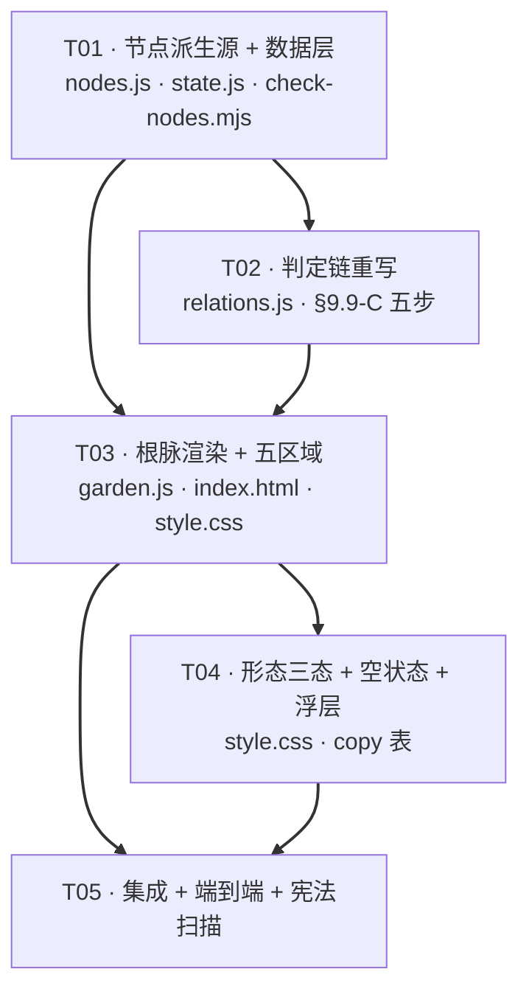

# 关系花园 V2 · 系统架构设计与任务分解

> 架构师：高见远（Gao）
> 版本：V2.0-garden-ecosystem
> 输入：`docs/prd/garden-relationship-graph-prd.md`（1136 行，含修订后 §9 + V2 §10）、`docs/design/garden-v2-baseline.md`（现状基线勘察）
> 状态：待开发
> 约束：遵守 V1 铁律（分层单向依赖 / 唯一写入口 / 零运行时依赖 / innerHTML 右值必过 `buildXxxHTML()`+`escapeHtml()`）

---

# Part A · 系统设计

## A.0 一句话架构

> **把「节点集合」从散落 6+ 处的硬编码，收敛为 `core/nodes.js` 的单一派生源；把「连接带」升级为「根脉」，但完整保留 V1 的读写分离防护；把三节点布局扩为五区域纵深构图，数据层与判定链是纯加法扩展。**

V2 = **A.1 单一节点源** + **A.2 根脉渲染** + **A.3 五区域分层** + **A.4 数据层加法** + **A.5 判定链**。

---

## A.1 单一派生源：根治节点硬编码

### A.1.1 问题回顾（来自基线勘察 §2）

节点集合字面量 `['family','partner','friend']`（及 `ROLE_NODES` 的平行定义）散落在 **6+ 处**：

| 文件:行号 | 现有硬编码 | 类型 |
|:---:|---|---|
| `core/relations.js:14–22` | `SCENE_KEYWORDS = {family,partner,friend}` | 词典 |
| `core/relations.js:25` | `PRIORITY = ['partner','family','friend']` | 优先级链 |
| `core/relations.js:110,118,124,130` | `['family','partner','friend'].includes(...)` ×4 | 枚举校验 |
| `core/relations.js:48` | `const result = {family:0,partner:0,friend:0}` | 计数初值 |
| `core/state.js:53–58` | `emptyStore()` 四桶字面量 | 数据结构 |
| `core/state.js:67` | `for (const node of ['family','partner','friend','none'])` | 遍历 |
| `core/state.js:139` | `sceneHint` 映射表 | 显示名 |
| `modules/garden.js:16–21` | `ROLE_NODES` 四节点 | 视图 |
| `modules/garden.js:127–130` | `presentNodes()` 硬编码数组 | 视图过滤 |
| `modules/garden.js:320` | `updateRoleForms()` 硬编码数组 | 视图循环 |
| `modules/garden.js:505` | 连接带点击 label 映射 | 视图文案 |

**V2 必须做的**：新建 **`src/core/nodes.js`** 作为**唯一权威定义**，其余全部改为**派生**。

### A.1.2 唯一定义位置：`src/core/nodes.js`（新建）

```js
// src/core/nodes.js —— 关系节点的唯一权威定义（Single Source of Truth）
//
// ⚠️ 宪法级约定（lint 强制，见 scripts/check-nodes.mjs）：
//   本文件是【全项目唯一允许出现节点 id 字面量 'family'/'partner'/'friend'/'child'/'colleague'/'none' 的地方】。
//   其它任何 .js 文件不得出现这些字面量（测试文件、本文件、注释除外）。
//   要新增节点 → 只改这里一处。

/**
 * 节点主定义表。顺序 = 展示顺序；用于一切派生。
 * @type {ReadonlyArray<{id:string, display:string, region:string, elId:string, anchorKey:string}>}
 */
export const NODES = Object.freeze([
  { id: 'family',    display: '家人', region: '家人 · 根系森林',   elId: 'eco-tree',      anchorKey: 'family' },
  { id: 'partner',   display: '爱人', region: '爱人 · 共生花园',   elId: 'eco-flower',    anchorKey: 'partner' },
  { id: 'friend',    display: '朋友', region: '朋友 · 流动溪谷',   elId: 'eco-stream',    anchorKey: 'friend' },
  { id: 'child',     display: '孩子', region: '孩子 · 新生苗圃',   elId: 'eco-nursery',   anchorKey: 'child' },
  { id: 'colleague', display: '同事', region: '同事 · 林间营地',   elId: 'eco-camp',      anchorKey: 'colleague' },
]);

/** 兜底节点（无名记录）：有数据桶、永不连根脉、无生态区域 */
export const NONE_ID = 'none';

/** 全部节点 id（含 none）——数据层遍历用 */
export const ALL_NODE_IDS = Object.freeze([...NODES.map((n) => n.id), NONE_ID]);

/** 具名关系节点 id（不含 none）——视图层遍历用 */
export const NAMED_NODE_IDS = Object.freeze(NODES.map((n) => n.id));

/** 生态区域节点 id（有可视化主体的节点 = 全部具名节点；V2 五区域全有主体） */
export const PRESENT_NODES = Object.freeze(NODES.map((n) => n.id)); // 语义别名，便于阅读

/** 判定优先级链（6 节点全序，来自 PRD §9.2(a)：partner > child > family > colleague > friend > none） */
export const PRIORITY = Object.freeze(['partner', 'child', 'family', 'colleague', 'friend', NONE_ID]);

/** 判定执行顺序（PRD §9.9-C 第 4 步：colleague → child → partner → family → friend） */
export const JUDGE_ORDER = Object.freeze(['colleague', 'child', 'partner', 'family', 'friend']);

/** id → NODES 条目（O(1) 查询） */
export const NODE_BY_ID = Object.freeze(
  Object.fromEntries(NODES.map((n) => [n.id, n]))
);

/** 由 id 取显示名（含 none 兜底） */
export function displayOf(id) {
  if (id === NONE_ID) return '无名记录';
  return NODE_BY_ID[id]?.display ?? '这段关系';
}
```

**关键**：`PRIORITY`（排序用，6 节点全序）与 `JUDGE_ORDER`（判定短路顺序，5 节点）是**两个不同的东西**，必须分开定义——PRD §9.2(a) 的「亲近度排序」用于并列消解，§9.9-C 的「固定顺序」用于短路。

### A.1.3 全部消费点的改造清单（逐处 文件:行号）

| # | 文件:行号 | 现状 | V2 改法 |
|:--:|---|---|---|
| 1 | `core/relations.js:14–22` | `SCENE_KEYWORDS` 3 键 | **新增 `child` / `colleague` 键**；键集合 = `NAMES_NODE_IDS \ {none}`（词典不含 none）。**这是唯一允许出现节点 id 字面量的数据文件之一**（check-nodes.mjs 对 `relations.js` 放行词典区） |
| 2 | `core/relations.js:25` | `const PRIORITY = [...]` | **删除本地定义**，改为 `import { PRIORITY, JUDGE_ORDER, NAMED_NODE_IDS } from './nodes.js'` |
| 3 | `core/relations.js:48` | `{family:0,partner:0,friend:0}` | 改为 `Object.fromEntries(NAMED_NODE_IDS.map(id => [id, 0]))` |
| 4 | `core/relations.js:110,118,124,130` | `.includes([...])` | 改为 `.includes(x)` 基于 `NAMED_NODE_IDS` |
| 5 | `core/relations.js`（新增） | 无 | 新增 `resolveRelationTarget` 的 **§9.9-C 五步结构**（见 A.5） |
| 6 | `core/state.js:53–58` | `emptyStore()` 4 桶字面量 | 改为 `Object.fromEntries(ALL_NODE_IDS.map(id => [id, {total:0,events:[]}]))` |
| 7 | `core/state.js:67` | `['family','partner','friend','none']` | 改为 `ALL_NODE_IDS` |
| 8 | `core/state.js:139` | `sceneHint` 映射 | 改为 `displayOf(node)`（从 nodes.js 派生） |
| 9 | `modules/garden.js:16–21` | `ROLE_NODES` 四节点 | **彻底删除**，改为 `import { NODES } from '../core/nodes.js'`。**不留 `ROLE_NODES` 别名**（team-lead 裁定：同一概念两个名字正是要根治的病根；`tests/garden.test.js` 未 import 它）。`check-nodes.mjs` 同步把 `ROLE_NODES` 列为**历史名词拦截**，防有人从 git 历史翻出复用 |
| 10 | `modules/garden.js:127–130` | `presentNodes()` 硬编码 | 改为读 `NAMED_NODE_IDS` + `isNodePresent` 过滤 |
| 11 | `modules/garden.js:320` | `updateRoleForms()` 硬编码 | 改为遍历 `NAMED_NODE_IDS` |
| 12 | `modules/garden.js:505` | 连接带点击 label 映射 | 改为 `displayOf(node)` |
| 13 | `modules/garden.js:24–29` | `FALLBACK_ANCHORS` 4 键 | **扩为 6 键**（见 A.3.3） |
| 14 | **`tests/*.js`** | 多处精确断言 | 见 Part B 测试纪律（**测试文件豁免 check-nodes 的字面量禁令**，但断言须改包容性） |

> **接受的字面量白名单**：`core/nodes.js`（唯一定义）、`core/relations.js:SCENE_KEYWORDS` 区（词典天然需字面量键）、所有 `tests/**`、`docs/**`、注释。

### A.1.4 防止未来再次硬编码：`scripts/check-nodes.mjs`（新建 lint 守卫）

与现有 `scripts/check-html.mjs` / `check-css.mjs` 同风格，接入 `npm run lint`：

```js
// scripts/check-nodes.mjs —— 节点 id 字面量守卫
// 规则：除白名单文件外，任何 src/**.js 不得出现 'family'|'partner'|'friend'|'child'|'colleague'|'none'
//       作为【字符串字面量】（注释与 import 路径不计）。
// 退出码非 0 → CI/本地 lint 失败。
```

- **白名单**：`src/core/nodes.js`、`src/core/relations.js`（仅 `SCENE_KEYWORDS` 声明块内的对象键行）、`tests/**`。
- **检测**：逐行扫描，正则 `/(['"])(family|partner|friend|child|colleague)\1/`（5 个非 none id，**无条件拦截**，剔除注释行与已白名单文件）。
- **追加拦截**：**禁止标识符 `ROLE_NODES` 出现**（team-lead 裁定，当作历史名词拦截——防止有人从 git 历史翻出复用，形成第二个节点来源）。
- **接入**：`package.json` 的 `"lint": "eslint . && npm run lint:html && npm run lint:css && npm run lint:nodes && npm run lint:garden-dom && npm run lint:constitution"`。
- **价值**：**未来任何人在 `garden.js` 里写死 `'child'` 都会在 CI 红灯**，把「二次硬编码」从「人工 review 才可能发现」升级为「机器强制拦截」。这是本设计对 §2 地雷 #2 的**根治手段**。

#### A.1.4.1 `'none'` 的判定规则（Bob 裁定 ①：**fail-closed**，非 fail-open）

**问题**：`'none'` 是全项目唯一一个**既是节点 id、又是 CSS 关键字**的字符串（`fill:'none'` / `style.display='none'` / `preserveAspectRatio='none'`…）。当前 src 里共有 **10 处** `'none'` 字符串字面量**全部是 CSS/属性值**（`welcome.js:51,83`、`space.js:24,52`、`report.js:887`、`garden.js:140,196,204,211,474`），真实节点语义的 `'none'` 只会**以 `NONE_ID` 标识符**出现（如 `relations.js:199` `node === NONE_ID`），**从不写裸字面量**。

**裁定**：**采用 fail-closed（宁可误报，不可漏报）**，规则如下——

| 情形 | 判定 | 依据 |
|---|---|---|
| 行内出现 `'none'` **且**匹配 `NONE_VALUE_HINT`（下方封闭白名单） | ✅ 放行（CSS 值） | 是已知的非节点语义 |
| 行内出现 `'none'` **且不**匹配 `NONE_VALUE_HINT` | ❌ **报错** | 无法证明它是 CSS 值 → 按「疑似节点字面量」拦 |
| 出现裸 `NONE_ID` / `nodes.js` / `relations.js:SCENE_KEYWORDS` 区 | ✅ 放行 | 唯一合法来源 |

**`NONE_VALUE_HINT`（封闭白名单，精确到「哪个属性名 + `'none'`」）**：

```js
// 仅当 'none' 是以下【已知非节点 API】的值时才放行：
const NONE_VALUE_HINT = new RegExp([
  'display', 'pointerEvents', 'pointer-events',            // style.* =
  'fill', 'stroke', 'stop-color',                          // setAttribute('fill','none')
  'animation', 'animationName', 'transition',              // style.animation='none'
  'preserveAspectRatio',                                   // setAttribute(...)
  'visibility', 'content', 'listStyle', 'list-style',
  'textDecoration', 'text-decoration', 'userSelect', 'user-select',
  'filter', 'outline', 'border', 'background', 'boxShadow', 'box-shadow',
  'transform', 'opacity'
].join('|'), 'i');
```

**匹配逻辑**：`NONE_LITERAL.test(line) && NONE_VALUE_HINT.test(line) → 放行；NONE_LITERAL.test(line) && !NONE_VALUE_HINT.test(line) → 报错`。（即工程师现有代码把 `NODE_CONTEXT_HINT` 换成 `NONE_VALUE_HINT`，逻辑由「有 node 语义就报错」反转为「有 CSS 语义才放行」，方向反转即达 fail-closed。）

**为什么 fail-closed 优于工程师原方案**：原方案要求行内出现 `node|scene|explicitScene|data-node|dataset.node|NONE_ID` 才报错——这会让**「`const FALLBACK = 'none';`」这类无上下文词的裸字面量静默漏网**，正是我们要根治的病。CSS 值是**封闭集合**（上表 24 个属性名即为全集，且项目零运行时依赖、无第三方注入），所以 fail-closed 的误报面极小；真有新 CSS 属性用到 `'none'`，**报错是响亮的、追加进白名单即可**，代价远低于一次静默硬编码。

- **加固（可选，同一任务内）**：把注释行豁免的**行内注释不豁免**纪律也写成单测（`tests/check-nodes.test.js`），固化「`const x = 'family'; // note` 必须报错」。
- **加固（可选）**：`'none'` 报错信息里提示「若这是 CSS 值，请把属性名加入 `NONE_VALUE_HINT`」，降低新人的困惑成本。

> **交付后自检命令**（写进 PR 模板）：`grep -rn "'\(family\|partner\|friend\|child\|colleague\)'" src/ --include=*.js` 应仅命中 `nodes.js` / `relations.js 词典区`。

---

## A.2 「根脉」渲染方案（替代连接带）

### A.2.1 保留的 V1 防护（**不得改动**）

| 防护 | 位置 | 为什么必须保留 |
|---|---|---|
| **读写分离两阶段** | `renderRelationGraph()` | `getBoundingClientRect()` 是强制同步布局；交替读写 → layout thrashing。五节点比三节点更严重。**必须：① 一次性读完 sceneRect + self + 全部锚点 → ② 只写 SVG** |
| SVG 坐标三件套 | `ensureGraphSvg()` | `viewBox="0 0 100 100"` + `preserveAspectRatio="none"` + `vector-effect="non-scaling-stroke"` |
| 逐节点档位判定 | `updateRelationshipBands()` | 依据 `relations[node].total`（分量，非全局） |
| `band-hit`（改名 `root-vein-hit`） | 每节点 | 根脉必须可点击（≥44px 热区） |
| `none` 永不连根脉 | `presentNodes()` | none 只出落叶/无名花 |
| resize 无变化短路 | `handleResize()` | 移动端地址栏/软键盘抖动防护 |

### A.2.2 根脉 SVG 结构

PRD §10.6.3 建议「同一 `<path>` 多段 `M...Q...`」实现分叉。**采纳，但做一处工程优化**：

```xml
<svg class="relation-graph" viewBox="0 0 100 100" preserveAspectRatio="none" aria-hidden="true">
  <g class="root-vein" data-node="family" data-tier="mid">
    <!-- 主干（始终存在） -->
    <path class="root-main"     d="M 50 72 Q 40 78 30 68" fill="none" vector-effect="non-scaling-stroke"/>
    <!-- 分叉（档位 ≥ mid 时由 JS 追加；同一 path 可用多段 M...Q...） -->
    <path class="root-branch"   d="M 44 75 Q 38 80 32 76 M 38 78 Q 34 83 28 80" fill="none" vector-effect="non-scaling-stroke"/>
    <!-- 流动光点层（仅 thick/full 显示） -->
    <path class="root-spark"    d="<与主干同 d>" fill="none" vector-effect="non-scaling-stroke"/>
    <!-- 命中区（加宽透明） -->
    <path class="root-vein-hit" d="<与主干同 d>" fill="none" vector-effect="non-scaling-stroke"/>
  </g>
</svg>
```

**分叉策略（关键决策）**：分叉**不由 CSS 生成**（CSS 无法在 `d` 属性上做条件分支），而由 **JS 在 WRITE 阶段**依据档位决定 `d` 内容：
- `thin`：仅主干，`d = bandPath(self, target)`（**复用现有 `bandPath()`**）。
- `mid`：主干 + `root-branch`（2 条小分叉，由主干中段偏移生成）。
- `thick` / `full`：主干 + `root-branch`（3–4 条分叉）。

分叉路径由纯函数 **`rootVeinPaths(mainD, tier)`** 生成（新增，可单测），从主干二次贝塞尔的控制点推算分叉起点，保证几何连续。

**为什么用多条 `<path>` 而非单条多段**：后续若要做「首次生长动效（`stroke-dashoffset`）」（PRD §10.8.2 / P2-1），多条 path 可分别控制长度，且样式（`root-main` / `root-branch` / `root-spark`）可独立分层——**单条多段 path 无法做到分叉先于主干淡入**。**采多条 path，用 CSS class 分层**。

### A.2.3 档位 → 根脉映射（复用 `nurtureTier()`，不新增阈值）

| 档位 | 主干 stroke-width | opacity | 分叉数 | 附加 |
|---|:---:|:---:|:---:|---|
| `thin` (0–33) | 1.5px | .28 | 0 | — |
| `mid` (34–66) | 3px | .55 | 2 | 静态微光 `filter:blur(2px)` |
| `thick` (67–99) | 5px | .85 | 3–4 | `root-spark` 流动光点 3s + 端点呼吸 |
| `full` (≥100) | 5px | .85 | 3–4 | 同 thick（视觉封顶，符合 P2-5 元素封顶） |

CSS 类命名：`.root-vein--thin|mid|thick|full`（**替换** 现有 `.band--*`）。

> ⚠️ **色调纪律**：PRD §10.6 定根脉色 `#D5A85A`（暖金），与 V1 一致；**禁止荧光/高饱和**（§10.3 D3）。

### A.2.4 从 `.band-*` 到 `.root-vein*` 的 CSS 迁移

| V1（删除） | V2（新增） | 说明 |
|---|---|---|
| `.band-line` | `.root-main` | 主干 |
| `.band-spark` | `.root-spark` | 光点 |
| `.band-hit` | `.root-vein-hit` | 命中 |
| `.band--thin/mid/thick/full` | `.root-vein--thin/mid/thick/full` | 档位 |
| — | `.root-branch` | **新增**分叉层 |

`@keyframes bandFlow` → 更名 `rootFlow`（逻辑不变）；`endpointBreath` 保留。

---

## A.3 五区域 DOM 与 CSS 分层

### A.3.1 现有 4 层能否容纳 5 区域？

**结论：不能直接容纳，必须重构为「纵深三层 + 核心层」的 5 层结构。**

V1 是 `.garden-bg`(z0) / `.garden-midlayer`(z3) / `.garden-fore`(z4) / `.garden-floor`(z5) —— 这是**「远近×前景」的 2 层空间**，塞不下 5 个独立生态区域。

**V2 采用 PRD §10.4.6 的纵深构图（远/中/前景 + 核心）**：

```
#garden-scene
├── canvas#gardenCanvas.garden-canvas                        z2  光斑
├── svg.relation-graph（根脉，5 个 <g class="root-vein">）    z6  顶层
├── .garden-bg（天空/太阳/雾山）                              z0
├── .garden-layer--far     远景层                             z1
│   └── .eco-camp#eco-camp[data-anchor=colleague]  同事·林间营地（最小/最冷/blur 1px）
├── .garden-layer--mid     中景层                             z3
│   ├── .eco-tree#eco-tree[data-anchor=family]     家人·根系森林（古树，左）
│   └── .eco-flower#eco-flower[data-anchor=partner] 爱人·共生花园（双株拱门，右）
├── .garden-layer--near    前景层                             z4
│   ├── .eco-nursery#eco-nursery[data-anchor=child] 孩子·新生苗圃（中左）
│   └── .eco-stream#eco-stream[data-anchor=friend]  朋友·流动溪谷（右）
├── .eco-seedling#eco-seedling[data-anchor=self]    自我·幼苗（核心，中央偏下）  z4
└── .garden-floor          地面                               z5
```

> `.garden-midlayer` / `.garden-fore` **废弃**，改名为 `.garden-layer--mid` / `--near`（`--far` 新增）。`#animal-zone` **迁移**为「朋友·流动溪谷」内的子组 `.stream-animals`（方案 A，用户已拍板）——动物不再是独立锚点，而是溪谷岸边的可点选生命体（**这是消除 V1 锚点重叠的关键**）。详见 A.6。

### A.3.2 锚点坐标表（⚠️ 解决基线地雷 #3：消除重叠）

**PRD §10.4 建议区间 → 归一化到 0–100 百分比（相对 `#garden-scene`）**：

| 节点 | 区域 | 建议 x（PRD） | **V2 锚点 (x,y)** | 尺寸基调 | 排除重叠的约束 |
|---|---|---|---|:---:|---|
| `self` | 自我·幼苗 | 中央偏下 | **(50, 72)** | 最小（42px 芽） | 根脉原点，所有根脉由此出 |
| `family` | 家人·根系森林 | 18–30% | **(24, 40)** | 中景大 | 左；右边界不得越过 x=34 |
| `partner` | 爱人·共生花园 | 48–62% | **(56, 42)** | 中景中大 | 右；左边界 ≥ x=44 |
| `child` | 孩子·新生苗圃 | 30–42% | **(36, 64)** | 前景小 | **必须与 self(50,72) 及 family(24,40) 各保持 ≥24px 视觉间距** |
| `friend` | 朋友·流动溪谷 | 68–88% | **(78, 62)** | 前景大 | 右；左边界 ≥ x=66 |
| `colleague` | 同事·林间营地 | 74–88% | **(81, 30)** | 远景最小 | 右上，y 更靠上（纵深）；不得与 partner(56,42) 视觉相撞 |

**与 V1 的对比**：

| 冲突 | V1 坐标 | V2 处理 |
|---|---|---|
| `#animal-zone`(50%) vs `#eco-flower`(46%) 水平重叠 | 二者中心距 < 5% | friend 移到 (78,62)，partner 移到 (56,42)，**间距 >20%** |
| child 无独立锚点 | — | child 独立 (36,64)，与 self(50,72) 间距 ≥14% |

> ⚠️ **锚点是「百分比归一化后」的建议值**；实际渲染仍由 `anchorOf(el, sceneRect)` **实测 DOM 中心**得出，`FALLBACK_ANCHORS` 只在 DOM 查询失败时使用。**必须在 320/375/480px 三档实测无重叠**（P0-2 验收）。

### A.3.3 `FALLBACK_ANCHORS` 完整兜底表（6 键全覆盖）

```js
export const FALLBACK_ANCHORS = Object.freeze({
  self:      { x: 50, y: 72 },
  family:    { x: 24, y: 40 },
  partner:   { x: 56, y: 42 },
  child:     { x: 36, y: 64 },
  friend:    { x: 78, y: 62 },
  colleague: { x: 81, y: 30 },
});
```

**为什么必须 6 键**：`renderRelationGraph` 的兜底是 `FALLBACK_ANCHORS[node]`；若缺 child 键，当 `#eco-nursery` DOM 查询失败时会得到 `undefined` → `bandPath(self, undefined)` → 抛错或产生 `M undefined undefined` → **整条根脉消失且可能中断整个渲染循环**。

**防呆增强**：在 `anchorOf` 调用处加断言——若 `FALLBACK_ANCHORS[node]` 为空，降级到 `FALLBACK_ANCHORS.self` 并 `console.warn`，**绝不产出 `undefined` 坐标**。

### A.3.4 五区域 CSS 分层规范

| 层 class | z-index | 色彩/模糊基调 | 包含区域 |
|---|:---:|---|---|
| `.garden-bg` | 0 | 远景雾山（现有） | — |
| `.garden-layer--far` | 1 | 最冷、`filter:blur(1px)`、最小尺度 | colleague |
| `.garden-layer--mid` | 3 | 色彩最实、主体尺度 | family, partner |
| `.garden-layer--near` | 4 | 最暖光、最清晰、最大尺度 | child, friend, self |
| `.garden-floor` | 5 | 地面（现有） | — |
| `.relation-graph` | 6 | 根脉（现有，顶层） | — |

---

## A.4 数据层改动面（纯加法）

### A.4.1 `core/relations.js` 改动清单

| 位置 | 改动 | 说明 |
|:---:|---|---|
| `SCENE_KEYWORDS`(14–22) | **新增 `child` / `colleague` 键** | 见 A.4.2 的词典分配 |
| `PRIORITY`(25) | **删除本地定义**，`import { PRIORITY, JUDGE_ORDER, NAMED_NODE_IDS }` | 单一源 |
| `PRIORITY` 值 | 改为 6 节点全序 `partner > child > family > colleague > friend > none` | PRD §9.2(a) |
| `countSceneHits`(46–61) | 计数初值改为派生 | 见 A.1.3 #3 |
| `pickMainAxis`(68–80) | 遍历 `PRIORITY`（自动跟随） | 无硬编码，改 PRIORITY 即可 |
| `resolveRelationTarget`(108–166) | **重写为 §9.9-C 五步结构** | 见 A.5 |
| 新增 `extractDirectParties()` | 新增纯函数 | 见 A.5.1 |

### A.4.2 `SCENE_KEYWORDS` 扩展（按 PRD §9.1 线索列 + G1–G4 规则分配）

> **词典纪律（宪法红线）**：只收中性称呼词。新增须产品评审。

```js
family: [
  '妈','爸','婆婆','公公','岳父','岳母','爷爷','奶奶','外公','外婆',
  '家里','养老',
  '哥','姐','弟','妹','姑姑','叔叔','表哥','亲戚',
  // ⚠️ V2 移除：'孩子','儿子','女儿','宝宝','上学','功课' → 迁往 child
],
partner: ['老公','老婆','男朋友','女朋友','对象','亲爱的','咱俩','结婚','伴侣','爱人'],
friend: ['兄弟','姐妹','闺蜜','发小','老同学','朋友','好友'],
child: ['孩子','儿子','女儿','宝宝','上学','作业'],           // ⚠️ '叛逆' 禁用（PRD §9.1 标注→禁用）
colleague: ['领导','老板','同事','项目','开会','绩效','客户','加班','汇报','上司','下属'],
```

**⚠️ 关键：`child` 的 6 个词必须从 `family` 中移除**（PRD §9.1 修订）。否则同一句「辅导儿子作业」会**双轴命中** `family`+`child`，即便 G3 顺序能救，也会污染 `family` 的背景计数。

**不收录 `none` 词典**：`none` 无词典，由 P5 兜底产生（G4）。P3/P4 阶段**禁止**直接写 `none`。

### A.4.3 `core/state.js` 改动清单

| 位置 | 改动 | 说明 |
|:---:|---|---|
| `RELATIONS_KEY`(26) | 不变 | 键名不变 → 老数据可读 |
| `emptyStore`(52–59) | 改为 `Object.fromEntries(ALL_NODE_IDS.map(...))` | **前向兼容的核心** |
| `normalizeStore`(63–75) | 遍历改 `ALL_NODE_IDS`，**保留 base 兜底写法** | 老数据自动补 child/colleague = 0 |
| `sceneHint`(138–140) | 改为 `displayOf(node)` | 派生 |
| typedef JSDoc(33–49) | 扩注释 | 文档同步 |
| `applyAnalysisToGarden`(153–221) | **零改动** | ✅ 它只做 `store[node]`，节点无关 |

### A.4.4 前向兼容（⚠️ 禁止 version 字段）

**保持现有范式：`normalizeStore` 以 `emptyStore()` 为底，逐键填充。** 老用户 `{family,partner,friend,none}` 读入后，`child`/`colleague` **自动补 0，零丢失**。

**三条纪律（写进文档，禁止违反）**：
1. **禁止引入 `version` 字段**与任何「版本不匹配就重建」的迁移逻辑。
2. `normalizeStore` 的遍历数组**必须与 `emptyStore` 的键集合严格一致**（现在二者都派生自 `ALL_NODE_IDS`，天然一致）。
3. `readRelations` 的 try/catch 兜底**不许动**（老数据损坏时的最后防线）。

### A.4.5 调用链确认

`applyAnalysisToGarden(analysis, opts)` 的**签名不变**，调用方 `report.js:633` **不改**。节点判定完全内聚在 `resolveRelationTarget` 内部，写入函数对节点集合无感知。**`modules/` 层零横向 import 的铁律不变**。

---

## A.5 判定链：照抄 PRD §9.9-C 五步结构

### A.5.1 第一步「确定直接参与方」——新增 `extractDirectParties()`

PRD §9.9-C 第 1 步需要「谁在场」。**现有代码没有此概念**，须新增纯函数：

```js
/**
 * 提取「直接参与方」的类型集合（谁在场）。
 * 来源优先级：analysis.parties[].label → conversation 前 3 行说话人标签。
 * @param {object} analysis
 * @param {object} opts {conversation}
 * @returns {Set<string>} 参与方命中的节点 id 集合（可能为空）
 */
export function extractDirectParties(analysis, opts = {}) { /* ... */ }
```

实现：对 `analysis.parties[].label`（若存在）+ `extractSpeakerLabels(conversation, 3)` 的标签文本做 `countSceneHits`，**返回值 > 0 的节点集合**，作为「直接参与方」判据。

### A.5.2 五步判定（对照 §9.9-C 逐行实现）

```js
export function resolveRelationTarget(analysis, opts = {}) {
  const a = (analysis && typeof analysis === 'object' && !Array.isArray(analysis)) ? analysis : {};
  const parties = extractDirectParties(a, opts);   // 第 1 步：谁在场

  // 第 2 步  P1 用户显式选择
  if (opts.explicitScene && NAMED_NODE_IDS.includes(opts.explicitScene)) return opts.explicitScene;

  // 第 3 步  P2 AI 结构化字段（当前为死路径，字段不存在则跳过）
  const structured = a.scene;
  if (typeof structured === 'string' && NAMED_NODE_IDS.includes(structured)) return structured;
  /* ...parties[].relation 分支同理... */

  // 第 4 步  P3/P4 关键词，按固定顺序（JUDGE_ORDER）短路
  const textP3 = collectP3Text(a);               // parties[].label/nickname + coreInsight.*
  const hitsP3 = countSceneHits(textP3);
  const hitsP4 = opts.conversation ? countSceneHits(extractSpeakerLabels(opts.conversation, 3)) : zeroHits();
  const hits = mergeHits(hitsP3, hitsP4);

  // ★ 4a colleague：命中专属词 且 直接参与方为职场
  if (hits.colleague > 0 && parties.has('colleague')) return 'colleague';
  // ★ 4b child：命中子代词 且 直接参与方为子女
  if (hits.child > 0 && parties.has('child')) return 'child';
  // ★ 4c partner：命中伴侣词 且 直接参与方为伴侣
  if (hits.partner > 0 && parties.has('partner')) return 'partner';
  // ★ 4d family：命中亲属词（此时 child/partner 已排除）
  if (hits.family > 0) return 'family';
  // ★ 4e friend：命中朋友词
  if (hits.friend > 0) return 'friend';

  // ★ 退化分支（team-lead 已裁定保留）：仅当「直接参与方为空集」时启用词频。
  //   一旦 parties 非空 → 词频【完全退出竞争】，一律由 4a–4e 的参与方判定决出。
  if (parties.size === 0) {
    const axis = pickMainAxis(hits);            // 用 PRIORITY 6 节点全序
    if (axis) return axis;
  }

  // 第 5 步  P5 兜底 → none（仅此处可产生 none，G4）
  return NONE_ID;
}
```

#### A.5.2.1 接口空位契约：`opts.explicitScene`（⚠️ 符号名冻结，禁止重命名）

**背景**：第 2 步 P1（用户显式选择「这段对话是关于…」）**本轮不做**（PRD §11.2 范围裁定：保留接口空位，UI 缺位时自然回落后续判定）。PRD 剥离后**已不再出现 `opts.explicitScene` 字面名**，故该符号名的**唯一出处移归本架构文档**——本节即为此契约的正式载体。

**冻结命名（不得重命名，不得改形参路径）**：

| 项 | 冻结值 | 说明 |
|---|---|---|
| **opts 键名** | `explicitScene` | 全小写驼峰，**不得**改为 `scene` / `explicitNode` / `forcedScene` / `selectedScene` 等 |
| **所在形参** | `resolveRelationTarget(analysis, opts)` 的 **第 2 个参数 `opts`** | 不得挪到 `analysis` 里（`analysis.scene` 是 **P2** 的另一条路径，二者不可混） |
| **合法取值** | `NAMED_NODE_IDS`（5 个具名节点）之一 | 不含 `none`；非法值应**忽略并回落**后续判定，不得抛错 |
| **缺省行为** | `undefined` | UI 未提供该空位时，第 2 步 `if (opts.explicitScene && NAMED_NODE_IDS.includes(opts.explicitScene))` 自然为假 → 回落第 3 步 |

**为什么必须冻结**：PRD 侧已按「剥离实现细节」删除该名，若工程师未来实现 P1 时**自创新名**，会出现「产品侧无记录、架构侧无锚点」的**接口名漂移**，且 `resolveRelationTarget` 的调用方（`report.js` 写入链）与测试会各自命名 → 形成第二个「同一概念多个名字」的病根（正是我们用 `nodes.js` SSOT 根治的那类病）。

**首次实现 P1 时的落点（预登记，非本轮范围）**：UI 放**输入页**（PRD §11.2：与「已粘贴」同屏，不放花园页）；数据从输入页 → 分析流程 → `resolveRelationTarget(analysis, { explicitScene })`；`analysis` 与 `opts` 的分工不变。**本轮不得实现**，仅此登记防漂移。

### A.5.3 三条硬约束的落实（PM 要求「不自行重排」）

| 硬约束 | 落实位置 | 说明 |
|---|---|---|
| **`colleague` 最先，带前置条件** | 4a，`&& parties.has('colleague')` | G2 修正版：词命中 **∧** 参与方为职场，缺一不可（防 H3「我老婆嫌我加班多」误吞） |
| **`child` 必须早于 `family`** | 4b 排在 4d 前 | G3：顺序固定，不得颠倒（防 H1） |
| **`none` 只能由第 5 步产生** | 仅末尾 `return NONE_ID` | G4：P3/P4 阶段不得直接写 none |

### A.5.4 退化分支的边界（✅ team-lead 已裁定：保留词频退化，但写死边界）

**裁定结论**：保留「直接参与方为空集 → 退化为词频最多者」分支。

**定位**：G1 的约束边界是「**有参与方时**」；空集属于**规则未覆盖的情形**，退化不构成违反。若改为「空集一律 `none`」，则实际使用中「无说话人标签」是常态（用户常直接粘贴没标注谁说的话），等于**绝大多数真实对话不给任何关系节点养分，花园几乎不生长**——这是产品级灾难，不可接受。

**⚠️ 写死的边界约束（必须遵守，防止未来误用）**：
> 退化分支（词频）**仅在「直接参与方为空集」时启用**；一旦 `extractDirectParties()` 返回**非空集**，**词频完全退出竞争**，一律由参与方判定（4a–4e）决出。**禁止未来任何人把词频重新引入「参与方已知」的场景。**

### A.5.5 `extractDirectParties()` 返回值语义（⚠️ 防误用）

```js
/**
 * 提取「直接参与方」（谁在场）。
 * @returns {Set<string>} 参与方命中的节点 id 集合。
 *
 * ⚠️ 语义约定（关键，易误用）：
 *   - 返回【空集】表示「**无法确定在场者**」，**不是**「确定没有人在场」。
 *   - 因此空集 → 走 A.5.4 的词频退化分支，而**不是**直接判 none。
 *   - 只有「非空集但 4a–4e 全未命中」时，才由第 5 步判 none。
 *   把空集理解为「没人在场」会导致花园几乎不生长（见 A.5.4 裁定理由）。
 */
export function extractDirectParties(analysis, opts = {}) { /* ... */ }
```

---

# Part B · 任务分解

## B.1 任务划分（5 个任务，按依赖排序）

> 遵循「≤5 任务」「每任务 ≥3 文件」「按模块/层次分组」「T01 必为基础/数据层」的规则。本项目无 npm 依赖变更（零运行时依赖铁律），故 T01 是**数据层 + 派生源**（而非 package.json 类基础设施）。

---

### T01 · 节点单一派生源 + 数据层（P0）

- **任务名**：建立 `core/nodes.js` 单一派生源，扩展数据层至 6 节点，验收旧数据兼容
- **源文件**：
  - 新建 `src/core/nodes.js`
  - 修改 `src/core/state.js`（`emptyStore`/`normalizeStore`/`sceneHint`）
  - 新建 `scripts/check-nodes.mjs`（lint 守卫）
  - 修改 `package.json`（接入 `lint:html` 同级脚本）
  - 修改 `tests/state.test.js`（扩桶断言改包容性 + 新增旧数据兼容用例）
- **依赖**：无
- **验收标准**：
  1. `ALL_NODE_IDS` = 6 键；`NAMED_NODE_IDS` = 5 键；`PRIORITY` / `JUDGE_ORDER` 定义正确且 `Object.freeze`
  2. 预置旧数据 `{family:{total:26,...},partner,friend,none}` → `readRelations()` 后 `child.total===0 && colleague.total===0`，**旧四桶数据零丢失**
  3. `node scripts/check-nodes.mjs` 通过（`state.js` 零字面量，且 `ROLE_NODES` 标识符被拦截）；`'none'` fail-closed 规则生效（A.1.4.1）——此时 `index.html` 尚未迁移，`'animal-zone'` 仍在过渡窗口内放行（A.6.5.1）
  4. `applyAnalysisToGarden` 签名与调用方 `report.js` **零改动**，`state.test.js` 全绿
- **优先级**：P0

---

### T02 · 判定链重写（P0）

- **任务名**：按 PRD §9.9-C 五步结构重写 `resolveRelationTarget`，扩展词典
- **源文件**：
  - 修改 `src/core/relations.js`（`SCENE_KEYWORDS` 扩 2 键、删本地 `PRIORITY`、新增 `extractDirectParties`、重写 `resolveRelationTarget`、`countSceneHits` 派生）
  - 修改 `tests/relations.test.js`（精确断言改包容性 + 新增 6 节点可达性 / 无双计 / H1–H4 截胡用例）
- **依赖**：T01（需 `nodes.js` 的 `PRIORITY`/`JUDGE_ORDER`/`NAMED_NODE_IDS`）
- **验收标准**：
  1. **6 节点可达性**（对应 V2-P0-8）：6 类场景文本各自落到正确节点
  2. **截胡用例**：H1(「辅导儿子作业，我妈又插嘴」→ child)、H3(「我老婆嫌我加班太多」→ partner，**不得误吞 colleague**)、H4(「项目上出了事，我爸一直说我」→ family)
  3. G4：无命中 → 仅 P5 产 `none`
  4. `relations.test.js` 全绿（V1 的 23 条 + 新增）
- **优先级**：P0

---

### T03 · 根脉渲染 + 花园模块五区域（P0）

- **任务名**：`garden.js` 从三节点星图升级为五区域根脉；DOM 扩为五区域纵深分层
- **源文件**：
  - 修改 `src/modules/garden.js`（删 `ROLE_NODES` 改派生、扩 `FALLBACK_ANCHORS`、重写 `renderRelationGraph`→根脉、`updateRelationshipBands`、`updateNurtureUI`、`updateRoleForms`、`bindGardenEvents`；新增 `rootVeinPaths()`）
  - 修改 `index.html`（花园页 DOM 229–331：新增 `.garden-layer--far/mid/near`、5 个生态区域、改导航）
  - 修改 `src/style.css`（花园段 513–693：`.band-*` → `.root-vein*`、五区域定位、响应式断点）
  - 修改 `tests/garden.test.js`（`FALLBACK_ANCHORS` 6 键断言 + `rootVeinPaths` 单测）
  - ✅ **方案 A 子项（用户已拍板）：溪边动物重排** —— 4 只 `.animal-sprite`（狐狸/兔子/松鼠/小鹿，**复用现有纯 CSS 实现，零新建素材**）从独立 `.animal-zone` 迁至溪谷岸边；`#animal-zone` → `#eco-stream`（区域根）+ `.stream-animals`（子组）；`.stream-animals` 锚点 **(74,70)**；`friend.elId` 改为 `'eco-stream'`。**完整契约见 A.6（DOM/事件/data-*/选中态/命名）**
- **依赖**：T01、T02
- **验收标准**：
  1. 五区域 DOM 齐备、`anchorOf` 实测锚点在 320/375/480px **无重叠**（P0-2；用矩形不相交判定，见 A.6.7）
  2. 根脉：`total` = 10/50/90 → stroke-width 1.5/3/5、opacity .28/.55/.85（P0-4）；`none` 永不生成根脉
  3. **读写分离两阶段结构保留**（源码 review 确认：WRITE 阶段零 `getBoundingClientRect()`）
  4. `handleResize` 尺寸短路保留
  5. `innerHTML` 右值均来自 `buildXxxHTML()` + `escapeHtml()`
  6. **溪边动物交互（方案 A）**：4 只 `.animal` 为 `<button>`，**事件委托挂在 `#garden-scene`**，键盘 `Enter`/`Space` 可选中，落盘 `zhijian-friend-animal`（键值不变），选中态 `aria-pressed="true"` + 暖金三段式视觉（A.6.4）；**零内联 onclick、零 window 挂载**
  7. `.stream-animals` 锚点 (74,70) 与 friend 主锚点 (78,62)、self(50,72) 均不重叠；`check-nodes.mjs` **在 `index.html` 完成迁移后**自动拦截 `'animal-zone'` 历史名词（迁移感知，见 A.6.5.1；**T03 收尾须重跑 `npm run lint:nodes` 确认守卫已收紧**）
- **优先级**：P0

---

### T04 · 视觉丰富度（形态三态）+ 空状态 + 浮层（P0/P1）

- **任务名**：五区域形态三态（加法非乘法）、首次空状态、标签浮层胶囊、季节轻浮层
- **源文件**：
  - 修改 `src/style.css`（各区域三态形态：新枝/开花/鱼/树洞/鸟巢/新帐篷；标签胶囊；空状态；元素封顶）
  - 修改 `src/modules/garden.js`（形态三态 class 驱动、空状态判定、胶囊文案表 `REGION_STATUS_TEXT`、季节浮层开关）
  - 修改 `index.html`（胶囊结构、季节浮层容器）
  - 新建 `src/core/copy.js`（或放 garden.js 常量区）——**全部定性文案表集中一处便于审校**（对应 P1-5 的池化原则）
  - 修改 `tests/garden.test.js`（文案表宪法词快照扩维）
  - ✅ **方案 A 子项（用户已拍板）：响应式调优防拥挤** —— 溪谷区 320px 降级策略（**交互元素永不可隐藏，装饰元素可降级**）；元素数量上限；不重叠验证。**完整规格见 A.6.7**
- **依赖**：T03
- **验收标准**：
  1. P0-3：改 `total` 为 10/50/90 → **元素总数增加**，`transform:scale()` **未用于整株**（正则扫描 CSS 确认）
  2. P0-6：全空时零根脉、零区域、仅幼苗 + 指定文案
  3. P0-5：胶囊 = SVG 图标 + 关系名 + 定性短语，文案按 §10.5 表驱动，**零 emoji 零分数**
  4. P1-4：季节浮层复用 `SEASONS`/`getSeasonIndex()`，**不可切换**
  5. P2-5：繁盛期元素封顶（不再增加）
  6. **溪谷窄屏降级（方案 A）**：320px 下①无横向滚动（`scrollWidth ≤ 320`）②装饰元素（石头/萤火虫/鱼）按 A.6.7 降级至元素总数 ≤8 ③**4 只动物全部保留可点**（`offsetParent !== null`）④锚点矩形两两不相交（脚本断言）
- **优先级**：P0（形态三态/空状态/胶囊/窄屏降级）/ P1（季节浮层）

---

### T05 · 集成 + 端到端验收 + 回归（P0）

- **任务名**：全链路集成、宪法正则扫描、6 节点端到端、D.10 写入链验证、测试全绿
- **源文件**：
  - 修改 `src/main.js`（确认 garden init 编排，如需）
  - 新建 `tests/nodes.test.js`（`core/nodes.js` 派生一致性 + 冻结性）
  - ~~新建 `scripts/check-constitution.mjs`~~ ✅ **已由架构师于 T05 前建成**（见 §B.6），T05 只需**接入验证 + 扩充**
  - 修改 `package.json`（接入 `check-constitution`）✅ **已接入**（`lint:constitution`）
  - 更新 `docs/design/garden-v2-architecture.md`（回填实测数据）
- **依赖**：T01–T04

#### B.6 `scripts/check-constitution.mjs`（✅ 已建成 · 架构师交付）

**职责边界（⚠️ 与 QA 的 E2E 明确分工，避免撞车）**：

| 层 | 归属 | 扫什么 |
|---|---|---|
| **静态源码文本** | **本脚本**（架构师） | `index.html`（文本节点 + `aria-label/title/placeholder/alt/value`，剔除 HTML 注释）· `src/**.js`（**字符串字面量**，剔除注释与 `SCENE_KEYWORDS` 匹配词典区）· `src/style.css`（仅 `content:` 值） |
| **运行时动态文案** | **QA 的 E2E** | 运行时拼接出来的 toast / 错误信息 / 模板插值结果（本脚本静态扫不到） |

**覆盖的 4 类违规**：① 禁用术语（宪法 §8 术语表 + §2 三大禁止 + 本产品「伴侣→爱人」约定）② emoji ③ 数字分数/百分比外显 ④ 见 §8 术语纪律。

**关键设计（防误报，已实测）**：
- **emoji 正则刻意不含箭头区** `U+2190–U+21FF`（`→` `↓` 是本产品合法排版字形，见 `arrow-layer`）——V1 曾误报 8 处，已修正。
- **`%` 规则跳过疑似 CSS 值**（`width:100%` / `rgba()` 等）——V1 曾误报，已修正。
- **`SCENE_KEYWORDS` 匹配词典区豁免禁用词检查**：`'伴侣'` 是**用来识别用户输入的词典词**（`relations.js:28`），不是产品文案，不算违规；但该区仍查 emoji。
- **逐行处理**（不整文件 strip），保证行号准确、不产生错位误报。

**当前状态**：`node scripts/check-constitution.mjs` → **exit 0 通过**（实测：无禁用术语 / 无分数外显 / 无 emoji）。
**T05 待办**：跑一次确认仍在绿；若 T03/T04 新增文案引入违规，就地修正（**不要放宽规则**）。

- **验收标准**：
  1. V2-P0-8 端到端：输入 6 类场景 → 6 节点各自 +gain，5 个有区域节点根脉档位随之变化；**child/colleague 非只读装饰**
  2. V2-P0-1：**`check-constitution.mjs` + QA 运行时扫描**双覆盖 → 无 `%`、无分数、无进度环、无禁用术语、无 emoji
  3. V2-P0-10：源码 review 确认 `energy` / 温度四档**未参与**任何阈值/宽度/opacity/排序
  4. `npm run check`（lint + test）全绿，测试总数 ≥ 74 + 新增
  5. `check-nodes.mjs` 通过 → 节点字面量仅存于白名单；**且验证守卫已「收紧到最终态」**：① 5 个非 none id 无条件拦截 ② `'none'` fail-closed（A.1.4.1，`NONE_VALUE_HINT` 生效、无裸 `'none'` 漏网）③ `ROLE_NODES` 无条件拦截 ④ `index.html` 无 `animal-zone` → `animalZoneMigrated === true`（A.6.5.1 过渡窗口已关闭）。**建议补 `tests/check-nodes.test.js` 固化上述 4 条**（含「行内注释不豁免」反向用例）
  6. **`check-constitution.mjs` exit 0**；且 `npm run lint` 全链（eslint + html + css + nodes + garden-dom + constitution）绿；**注意仓库根目录不得残留 `_*.mjs` / `_*.log` 调试脚手架**（会被 `eslint .` 扫到并报 `no-undef`，导致 lint 误红）
- **优先级**：P0

---

## B.2 依赖图



**关键路径**：T01 → T02 → T03 → T04 → T05（线性为主）。

## B.3 可并行任务组合

| 波次 | 可并行 | 说明 |
|:--:|---|---|
| 第 1 波 | **T01（唯一）** | 一切的前提，串行 |
| 第 2 波 | **T02 ∥（T03 骨架准备）** | T02（判定链）与 T03 的 **DOM/CSS 布局部分**无代码依赖——可让一名工程师先改 `index.html` 五区域结构 + `style.css` 分层，与 T02 并行；但 T03 的 `garden.js` 根脉渲染**必须等 T02 的 `nodes.js` 派生接口**（已在 T01 就绪）与 T02 完成 |
| 第 3 波 | **T04 ∥ T05 的脚本准备** | T04（形态/文案）与 T05 的 `check-constitution.mjs` / `nodes.test.js` **无相互依赖**，可并行；T05 的端到端验收须等 T04 |
| 收敛 | T05 收口 | 串行 |

> **推荐执行**：T01 → (T02 ∥ T03-布局) → T03-渲染 ∥ T04 → T05。在只有一名工程师时纯串行亦可，任务粒度已控制。

## B.4 测试改造纪律（写进 team，防 hack 生产代码）

> **⚠️ 纪律**：扩容会让「精确结构断言」批量爆红。**必须先把测试改宽，再改生产代码**——顺序不可颠倒。
>
> 1. **`toEqual({family:0,partner:0,friend:0})`**（`relations.test.js:63,67`）→ 改为**逐键断言**或 `toMatchObject`（只断言关心的键）。
> 2. **`toEqual({family,partner,friend,none})`**（`state.test.js:21–26`）→ 显式断言 6 键存在 + 值正确，或 `toMatchObject`。
> 3. **禁止**为了让旧断言通过而**在生产代码里回退为 3 键**（这是最危险的 hack，会破坏 V2 全部功能）。
> 4. 测试文件**豁免** `check-nodes.mjs` 的节点字面量禁令（测试需要构造节点数据）。

## B.5 必须新增的测试点

| 测试点 | 文件 | 断言 |
|---|---|---|
| **6 节点可达性** | `relations.test.js` | 6 类场景文本 → 6 节点各自命中（V2-P0-8） |
| **截胡 H1/H3/H4** | `relations.test.js` | child 不被 family 抢；colleague 不误吞 partner/family |
| **G4 兜底** | `relations.test.js` | P3/P4 未命中的场景 → `none`（且仅一眼出口） |
| **无双计** | `relations.test.js` | 同一句话的 child 词不再计入 family（child 词已从 family 移除） |
| **旧数据兼容** | `state.test.js` | 旧 4 桶数据读入 → child/colleague 补 0，旧数据零丢失 |
| **根脉档位** | `garden.test.js` | `rootVeinPaths(d, tier)` 纯函数：thin 无分叉、mid 2 条、thick 3–4 条 |
| **兜底锚点全键** | `garden.test.js` | `FALLBACK_ANCHORS` 含 6 键且坐标 ∈ [0,100] |
| **nodes.js 派生一致** | `nodes.test.js` | `NAMED_NODE_IDS`/`PRIORITY`/`JUDGE_ORDER` 关系正确、对象冻结 |
| **宪法文案快照** | `garden.test.js` | 五区域文案表无禁用词（扩 `STATUS_TEXT` 快照） |
| **`energy` 不驱动视觉** | `garden.test.js`（静态扫描） | 源码中 `energy` 不出现在任何 width/opacity/tier 计算（可做正则断言） |

---

# Part C · 共享知识（跨文件约定）

## C.1 分层单向依赖（不变）

```
main.js → modules/* → core/*
```
- `core` 绝不 import `modules`。
- **`modules` 之间零直接 import**（跨模块走 core 数据层 或 `goTo()` + `navigate` 事件）。
- `garden.js` **只读账本**（`readRelations()`），不导出任何写入函数。

## C.2 唯一写入口（不变）

- `zhijian-relations` 唯一写入口 = `core/state.js` 的 `applyAnalysisToGarden()`。
- 唯一调用方 = `report.js` 的 `renderReport()` 尾部（**fire-and-forget，不 await，异常内部吞**）。
- 数据归属见 PRD §9.5 / 本架构 A.4.5。

## C.3 必须保留的防护清单（⚠️ 谁破坏谁负责）

| # | 防护 | 位置 | 不可破坏的原因 |
|:--:|---|---|---|
| 1 | **读写分离两阶段** | `garden.js renderRelationGraph` | 防 layout thrashing，五节点更严重 |
| 2 | **SVG 坐标三件套** | `ensureGraphSvg` + 每个 path | `viewBox 0 0 100 100` + `preserveAspectRatio:none` + `vector-effect:non-scaling-stroke`，去掉则坐标/描边全错 |
| 3 | **resize 尺寸短路** | `garden.js handleResize` | 移动端地址栏/软键盘抖动防护 |
| 4 | **逐节点档位** | `updateRelationshipBands` | 依据 `relations[node].total`（分量），**非全局** `zhijian-nurture` |
| 5 | **`none` 永不连根脉** | `presentNodes` 过滤 | PRD §9.3 |
| 6 | **零 `!important`** | `style.css` | 仅 `prefers-reduced-motion` 例外 |
| 7 | **`innerHTML` 右值必过 `buildXxxHTML()` + `escapeHtml()`** | 全部模块 | XSS 防线 |
| 8 | **零运行时依赖** | `package.json` `dependencies:{}` | 铁律 |

## C.4 数据约定

- **总览与分量解耦**：`zhijian-nurture` = 全局总量（仅顶部卡片）；`zhijian-relations.<node>.total` = 各节点分量（**根脉档位唯一依据**）。
- **`energy` 字段**：`'understand'|'repair'|'connect'`，**纯文案元数据**，不参与任何阈值/宽度/opacity/排序（PRD §10.7.2 / V2-P0-10）。
- **关系温度四档**：`还很安静/有些暖意/正在靠近/温暖`，**不参与任何计算**，只驱动一句文案 + 一处色温。
- **localStorage 键**：`zhijian-relations`（账本，不变）、`zhijian-nurture`（总量，不变）、`zhijian-friend-animal`（动物选择，不变）、`zhijian-garden-first-growth`（**V2 新增**，首次生长动效幂等标记）。
- **去重**：24h 窗口，`dedupeKey = SHA-1(前16位)` 首选 / FNV-1a 降级，**只存哈希不存明文**。
- **节点显示名**：家人 / 爱人 / 朋友 / 孩子 / 同事（注意「爱人」非「伴侣」）。

## C.5 JSON schema（events）

```jsonc
{
  "family":    { "total": 26, "events": [ /* RelationEvent */ ] },
  "partner":   { "total": 41, "events": [] },
  "friend":    { "total": 8,  "events": [] },
  "child":     { "total": 0,  "events": [] },   // V2 新增
  "colleague": { "total": 0,  "events": [] },   // V2 新增
  "none":      { "total": 3,  "events": [] }
}
// RelationEvent 新增字段：
//   energy: 'understand' | 'repair' | 'connect'   ← V2 新增（纯标记）
```

---

# Part D · 风险与待明确事项

## D.1 风险清单（按风险降序）

| # | 风险 | 缓解 |
|:--:|---|---|
| 🔴 1 | 破坏读写分离 → 五节点 layout thrashing | T03 验收含「WRITE 阶段零 rect 读取」源码 review；写入布局指引为强制项 |
| 🔴 2 | 节点硬编码漏改 → 新区域静默不显示 | **`scripts/check-nodes.mjs` 机器拦截**（根治手段），CI 红灯 |
| 🟠 3 | 锚点重叠 / `FALLBACK_ANCHORS` 缺键 → `M undefined undefined` | 6 键兜底表 + `anchorOf` 缺键降级断言 + 320/375/480px 实测 |
| 🟠 4 | child 词未从 family 移除 → 双轴命中 / H1 截胡 | A.4.2 明确移除；T02 新增「无双计」用例 |
| 🟠 5 | G2 误吞（H3） | 4a 强制 `&& parties.has('colleague')`；T02 含 H3/H4 回归用例 |
| 🟡 6 | P2 死路径被误以为生效 | 文档明确标注「P2 当前为死路径，V1.2 backlog」；代码注释同步 |
| 🟡 7 | 旧数据丢失 | 禁止 version 迁移；T01 含旧数据兼容用例 |
| 🟡 8 | 形态「变大」而非「变丰富」 | 正则扫描 CSS `transform:scale()` 不得用于整株；T04 验收 |
| 🟡 9 | `energy`/温度被偷偷拿去调线宽（换皮分数） | V2-P0-10 源码 review + T05 静态扫描 |
| 🟢 10 | `!important` 死灰复燃 / z-index 冲突 | 五区域 z-index 表已定；lint 扫描 `!important` |
| 🟠 11 | **溪谷元素密度过高**（方案 A 已知风险：溪流+石头+鱼+萤火虫+4 动物共存，320px 易拥挤/重叠） | **已升级为已知风险**。缓解：A.6.7 320px 降级策略（装饰元素可降级、交互元素永不可隐藏、元素总数 ≤8）+ 锚点 (74,70) 与各主锚点间距校验 + T04 脚本断言矩形不相交 + 人工截图确认 |

## D.2 已裁定事项（team-lead 复核 + 用户拍板后定稿）

| # | 事项 | 裁定 | 落地位置 |
|:--:|---|---|---|
| **1** | 「直接参与方为空集」时退化为词频 | ✅ **保留词频退化分支**；但写死边界：仅空集时启用，非空集时词频完全退出竞争 | A.5.2 代码注释 + A.5.4 边界约束 + A.5.5 JSDoc 语义 |
| **2** | `ROLE_NODES` 旧导出名 | ✅ **彻底删除，不留别名**；`check-nodes.mjs` 追加拦截该标识符 | A.1.3 #9 + A.1.4 |
| **3** | `PRIORITY` 与 `JUDGE_ORDER` 分离定义 | ✅ 认可（并列消解排序 ≠ 短路判定顺序） | A.1.2 |
| **4** | `check-nodes.mjs` 机器守卫 | ✅ 认可（根治二次硬编码） | A.1.4 |
| **5** | `extractDirectParties()` 为判定链心脏 | ✅ 认可 | A.5.1 / A.5.5 |
| **6** | `#animal-zone` 动物选择交互 | ✅ **用户拍板 → 方案 A：保留动物选择，迁移到溪边**（`#animal-zone` → `#eco-stream` + `.stream-animals`；交互契约见 A.6） | D.3 / A.6 |

## D.3 ✅ 已裁定（用户拍板）：方案 A —— 保留动物选择，迁移到溪边

> **状态**：用户已拍板。**保留「选一只小动物」交互**，将其从独立 `.animal-zone` 迁移为「溪边的小动物」。数据结构、`zhijian-friend-animal` 键、点击动效**全部沿用**，零迁移。详见 **A.6「溪边动物交互契约」**（新增章节，工程师实现依据）。

### D.3.1 数据影响（实测，已在方案 A 下复核）

| 项 | 结论 | 证据 |
|---|---|---|
| `zhijian-friend-animal` 会被丢弃吗？ | **不会**，且**继续沿用**。独立 localStorage 键，`normalizeStore()` 只处理 `zhijian-relations`，**从不触碰它** | `state.js:63–75` |
| `source: 'animal'` 事件存在吗？ | **实际不存在**。`source` 枚举（`state.js:38`）声明了 `'animal'`，但**全代码库从未写入过该值**——`applyAnalysisToGarden` 硬编码 `source:'analysis'`（`state.js:198`）；动物点击处理（`garden.js:468–481`）**只写 `zhijian-friend-animal`、不写 relations** | `state.js:198`、`garden.js:468–481` |
| 动物点击是否加养分？ | ⚠️ **不加**。它只 `waterCreature('animal-zone')`（纯动效）+ 存选择（`garden.js:480`，无 `addNurture`）。真正的 `+1 养分` 来自点击 `eco-tree/eco-flower/eco-seedling`（`garden.js:490–491`） | 已核 |

> **方案 A 结论**：迁移**零数据迁移成本**——键名、键值语义、点击动效全部保留，仅**改变动物的空间位置与容器**。

### D.3.2 方案 B（未采纳，记录备查）

原方案 B「去掉动物选择，纯观赏溪流」保留此处仅供追溯——**未被采纳**。若未来需回退，删 `.animal-zone` 系列即可（`zhijian-friend-animal` 历史值不丢）。

### D.3.3 技术判断（保留归档）

| 维度 | 方案 A（✅ 采纳） | 方案 B（未采纳） |
|---|---|---|
| 实现成本 | 中：重排溪谷元素 + 迁移动物定位 + 保留 click/chosen 逻辑 | 低 |
| 数据/逻辑风险 | 低 | 低 |
| 视觉风险 | 中：溪谷元素密度高，需响应式调优（**见 A.6.4 + D.1#11**） | 低 |
| 交互延续性 | **高**（用户习惯保留） | 低 |
| 与 PRD §10.4.3 一致性 | 中（PRD 元素清单未列动物——按用户裁定以「交互延续」优先） | 高 |

---

## A.6 溪边动物交互契约（⚠️ 方案 A 落地规范，工程师实现依据）

> 本节是方案 A 的**实现契约**。重点：**迁移后「选动物」如何落到 DOM / 事件上**，且**必须与已完成的 V1 无障碍整改口径一致**。

### A.6.1 无障碍前提（硬约束）

V1 已完成无障碍整改：**全项目零内联 `onclick`、零 `window.*` 全局挂载**（`main.js` 仅 22 行纯编排，`garden.js` 用 `addEventListener`）。因此溪边动物交互**只能走事件委托**，**不得**引入内联 `onclick`、不得挂 `window.selectAnimal`。

### A.6.2 DOM 结构与 `data-*` 契约

**触发元素**：与 V1 一致，**可点击单元 = `.animal` 包裹层**（内含 `.animal-sprite` + `.animal-name`），`sprite` 本身是装饰、不单独绑定。

```html
<!-- 朋友 · 流动溪谷（friend 区）—— 溪边动物（迁移后） -->
<div class="eco-stream" id="eco-stream" data-anchor="friend">
  <div class="stream-bed">…溪流/石头/鱼/萤火虫…</div>

  <!-- 溪边可点选动物组（沿用 .animal-zone 的语义，见 A.6.5 命名） -->
  <div class="stream-animals" role="group" aria-label="选一位溪边小伙伴">
    <p class="animal-hint" id="animal-hint">选一位小伙伴吧</p>
    <button class="animal" type="button" data-animal="fox"      aria-pressed="false" title="狐狸 · 灵动聪慧">
      <span class="animal-sprite fox-sprite" aria-hidden="true"></span>
      <span class="animal-name">狐狸</span>
    </button>
    <button class="animal" type="button" data-animal="rabbit"   aria-pressed="false" title="兔子 · 温柔陪伴">…</button>
    <button class="animal" type="button" data-animal="squirrel" aria-pressed="false" title="松鼠 · 活泼开心">…</button>
    <button class="animal" type="button" data-animal="deer"     aria-pressed="false" title="小鹿 · 优雅从容">…</button>
  </div>
</div>
```

**契约要点**：
- **触发元素**：`.animal` 改成 **`<button type="button">`**（V1 是 `<div>`）——这**天然获得键盘 `Enter`/`Space` 触发**，无需手写 keydown；符合无障碍。
- **`data-animal`**：值不变（`fox|rabbit|squirrel|deer`）→ **`zhijian-friend-animal` 键值零变化**。
- **`aria-pressed`**：选中态的可访问表达（详见 A.6.3）。
- **`aria-hidden="true"`** 加在 `.animal-sprite`（纯装饰，读屏跳过）。
- **`aria-label`** 在 `.animal-name` 提供可读名（按钮文本即「狐狸」等）。

### A.6.3 事件契约（事件委托）

| 项 | 契约 |
|---|---|
| **委托挂载点** | `#garden-scene`（`bindGardenEvents` 内对 scene 绑一次），**不在每个 `.animal` 上绑**（与 V1「按元素绑」不同——V1 是 4 个元素，V2 委托更稳，避免重绘后失效） |
| **事件类型** | `click`（**唯一一种**）。键盘 `Enter`/`Space` 由原生 `<button>` 自动派发为 `click`，**无需额外监听 keydown** |
| **判定** | `const btn = e.target.closest('.animal'); if (!btn) return;` |
| **`data-*` 读取** | `const animal = btn.dataset.animal;`（值为 `fox|rabbit|squirrel|deer`） |
| **落盘** | `localStorage.setItem('zhijian-friend-animal', animal)`（**键名不变**） |
| **动效** | 沿用 `waterCreature(btn.closest('.eco-stream')?.id ?? 'eco-stream')` —— 见下方说明 |
| **是否加养分** | **不加**（保持 V1 行为：动物点击不加养分，避免与「分析」来源混淆；若产品后续要加，须单独拍板） |
| **选中态更新** | 见 A.6.3 选中态视觉 |

> ⚠️ **`waterCreature` 的传入 id**：V1 传 `'animal-zone'`。迁移后 `.animal-zone` 若更名（见 A.6.5），须传新容器的 `id`（`'eco-stream'`）或保留一个内层 `id="animal-zone"` 作为浇灌目标锚。**推荐：浇灌目标 = 被点动物自身**（`waterCreature` 只需一个存在的元素 id；可给每只 `.animal` 一个 `id="animal-fox"` 等，或直接对 `btn` 元素做动效——后者更精确）。**本契约采用：对 `btn` 本身做动效**，即重构 `waterCreature` 使其接受元素或 id（向后兼容：`byId(id) || 传入元素`）。

### A.6.4 选中态视觉（必须与「根脉 / 养分」视觉语言一致）

**不能只是变色**。选中态须沿用 V1 `.animal.chosen` 的**暖金句法**（与根脉同色系 `#D5A85A`），升级为三段式：

| 表达层 | 值 | 与视觉语言的一致性 |
|---|---|---|
| **容器底** | `background: rgba(213,168,90,.2)` | 与根脉主色 `#D5A85A` 同源（低透明度暖金） |
| **外发光** | `box-shadow: 0 0 18px rgba(213,168,90,.35)` | 与 `.root-vein--mid` 的 `drop-shadow` 同色同强度 |
| **选中标记** | 动物头顶出现**一枚极小的暖金光点**（复用 `.root-spark` 的光点语言，非新素材） | 与「根脉流动光点」呼应，暗示「这条关系有我的选择」 |
| **可访问态** | `aria-pressed="true"` | 读屏可感知 |

> **纪律**：**零 emoji、零分数、零进度**（PRD §10.3 D1/D3）；光点用**暖金低透明度**，**不得荧光**。

### A.6.5 `.animal-zone` id 更名决策

**结论：更名 `#animal-zone` → 内层保留 `.stream-animals`（class，不带 id）；外层区域容器 `#eco-stream` 承担锚点。**

**理由**：
1. `#animal-zone` 表达的是「独立的动物选择区」——**V2 它已不是独立区域**，而是**朋友·流动溪谷内的一个子组**。保留旧 id 名会误导（暗示它仍是独立锚点）。
2. 命名风格与 `.root-vein*` 对齐：**区域内子元素用语义 class**（`.stream-animals` / `.stream-bed`），**区域根用 `#eco-xxx`**（`#eco-stream` / `#eco-nursery` / `#eco-camp` …），与 `nodes.js` 的 `elId` 一致（A.1.2：`friend → elId: 'eco-stream'`）。
3. **兼容性**：`garden.js` 中所有 `byId('animal-zone')` / `.animal-zone` 选择器改为 `#eco-stream` / `.stream-animals`；`ROLE_NODES` 中 `friend.elId` 由 `'animal-zone'` → `'eco-stream'`（已在 A.1.2 定义）。
4. `check-nodes.mjs` **追加拦截 `'animal-zone'` 历史名词**（与 `ROLE_NODES` 同理，防复活）——**但采用「迁移感知」判定，这是有意的过渡期设计，不是漏洞**（Bob 裁定 ②，见下方 A.6.5.1）。

### A.6.6 锚点坐标（溪边动物组）——满足同层间距 >20% 约束

**约束回顾**：五区域主锚点同层间距须 >20%（A.3.2）。friend 主锚点为 **(78, 62)**。动物组是 friend 区**内部子组**，须**不越出 friend 区域边界**，也不与 friend 主锚点（78,62）视觉打架。

**方案**：动物组锚定在 **friend 区域左缘、溪流岸边**（溪流自中景右下流入前景，动物坐岸边）：

| 元素 | 建议锚点 (x,y) | 依据 |
|---|---|---|
| **friend 区域主锚点**（`#eco-stream`，根脉终点） | **(78, 62)** | A.3.2 既定，不变 |
| **溪边动物组中心**（`.stream-animals`） | **(74, 70)** | 主锚点左下方 4%/8%，**在 friend 区内**（friend 区 x∈[66,88]）；与主锚点视觉距离足够（不重叠）；y=70 落在前景溪岸 |
| **4 只动物横向排布** | 围绕 (72,70) 横向铺开，单只宽 ≈32px，4 只 + gap ≈ 150px（对应 ≈18% 场景宽） | 紧凑但不拥挤；320px 下走降级策略（A.6.7） |

**间距校验**：
- 动物组中心 (72,70) 与 friend 主锚点 (78,62)：Δx=6%, Δy=8% → **不重叠**（动物组在溪岸下方，主锚点在溪谷上方）。
- 动物组中心 (72,70) 与 self(50,72)：Δx=22% → **>20% ✓**。
- 动物组与 colleague(81,30)、partner(56,42)、child(36,64)、family(24,40) 均远离 → **无冲突**。
- 动物组**未越出 friend 区右边界**（88）与左边界（66）？—— 组宽 ≈18% 居中于 72 → 覆盖 [63,81]，**左缘 63 略越 friend 左界 66**。**修正**：动物组中心定为 **(74, 70)** → 覆盖 [65,83]，落在 friend 区 [66,88] 内（左缘 65 允许 1% 视觉溢出，属溪岸自然延伸）。

> **最终锚点**：`.stream-animals` 中心 **(74, 70)**；根脉终点仍为 `#eco-stream` 主锚点 **(78, 62)**。

### A.6.5.1 `'animal-zone'` 拦截采用「迁移感知」（Bob 裁定 ②：**接受，标注为有意的过渡期设计**）

**裁定**：**接受**工程师的迁移感知方案——`check-nodes.mjs` 读取 `index.html`，**仅当 `index.html` 已不再包含 `animal-zone`（即 T03 迁移完成）后**，才对 `src/**.js` 里的 `'animal-zone'` 字面量报错；迁移未完成时放行。

**理由（为什么这是设计而非漏洞）**：

| 论点 | 说明 |
|---|---|
| **迁移有跨任务的时序** | `index.html` 的 DOM 改名（T03）与 `garden.js` 的选择器改名（T03）**同属 T03**，但 T01/T02 交付时 `garden.js` 仍引用 `#animal-zone`（合法、有待迁移）。若**无条件拦截**，T01 阶段 CI 立即红，等于把 T03 的工作硬拉进 T01，破坏任务边界。 |
| **「无条件拦截」会把 `garden.js:459/476` 拉进 T01 scope** | 这是**扩大 T01 边界**，与「T01=基础设施、T03=视图迁移」的分层相悖；且会让 T01 验收依赖一份尚未迁移的 `index.html`，制造虚假耦合。 |
| **迁移感知是「收敛式」守护，不是「永远放行」** | 判定条件绑定 `index.html` 的**客观状态**，一旦迁移完成，守卫**自动收紧**、此后任何 `'animal-zone'` 复活都会被拦。它只在「迁移正在进行的窗口」内放行，窗口由 T03 关闭。 |
| **安全兜底** | 即使 T03 漏改某处 `.animal-zone` 选择器，**T03 的验收项 7** 与 **T04 的锚点不重叠脚本断言**会红灯（`.stream-animals` 若不存在，`getBoundingClientRect()` 取不到、断言失败）——即**行为层测试兜住了守卫的窗口期**，不存在静默失效。 |

**落地规则（工程师已在 T01 实现，此处固化）**：

```js
// 迁移感知：animal-zone 仅在 index.html 完成迁移后才拦截
const indexHtml = readFileSync('index.html', 'utf8');
const animalZoneMigrated = !indexHtml.includes('animal-zone');
if (animalZoneMigrated) {
  HISTORY_NAMES.push({ re: /(['"])animal-zone\1/, label: "'animal-zone'" });
}
// ROLE_NODES 恒无条件拦截（无时序依赖，已彻底删除）
```

| 历史名词 | 拦截强度 | 理由 |
|---|---|---|
| `ROLE_NODES` | **无条件** | 已彻底删除，无迁移窗口；无条件拦截防「从 git 历史翻出复用形成第二节点源」 |
| `'animal-zone'` | **迁移感知**（绑定 `index.html` 状态） | 存在 T01→T03 迁移窗口；窗口由 T03 关闭后自动收紧 |

**收尾要求（T03 必须兑现，写入 T03 验收）**：T03 完成 `index.html` 去 `animal-zone` 后，**必须本地重跑 `npm run lint:nodes` 并确认 `animalZoneMigrated === true`**（即守卫已收紧、无残留 `'animal-zone'`）。**这是把「过渡期设计」正式关闭的仪式**，防止窗口永久敞开。

### A.6.7 320px 窄屏降级策略（防拥挤）

| 元素 | ≥480px | 375–479px | **≤320px 降级** |
|---|---|---|---|
| 溪流主体 | 全显 | 全显 | 全显（主视觉） |
| 石头 | 3–5 块 | 3 块 | **隐藏至 1–2 块**（`.stream-stone:nth-child(n+3){display:none}`） |
| 鱼 | 按档位 2–5 尾 | 2–3 尾 | **保留 2 尾**（封顶） |
| 萤火虫 | 按档位 0–6 只 | 2–3 只 | **保留 2 只**（封顶） |
| **溪边动物（4 只）** | 横排 4 只 | 横排 4 只，`gap` 缩小 | **保留全部 4 只，`gap` 缩至最小 + `transform:scale(.85)`**（**不得隐藏**——交互元素必须可达） |
| 动物名 `.animal-name` | 显示 | 显示 | **隐藏**（`display:none`，用 `aria-label` 保可访问；省空间） |
| 元素总数上限 | ≤ 12 | ≤ 10 | **≤ 8** |

**降级纪律**：**交互元素（动物）永不可隐藏**，只可缩小/合并；**装饰元素（石头/萤火虫/鱼）可降级隐藏**。这与 PRD §10.8「空境美学」一致。

**验证方式**（写入 T04 验收）：
1. **320px 视口**：`document.documentElement.scrollWidth <= 320`（无横向滚动，P0-2）。
2. **锚点不重叠**：脚本读取 `#eco-stream` / `#eco-nursery` / `.stream-animals` 的 `getBoundingClientRect()`，断言两两中心距 ≥ 各自宽高的一半之和（用矩形不相交判定，比百分比更可靠）。
3. **交互可达**：320px 下 4 只 `.animal` 仍可 `click`（`offsetParent !== null`）。
4. **截图人工确认**：溪谷区元素不互相遮挡。

---

---

## 附：文件清单（V2 涉及）

```
新建:
  src/core/nodes.js                          ← 节点单一派生源（核心新增）
  scripts/check-nodes.mjs                    ← 节点字面量 lint 守卫
  scripts/check-constitution.mjs             ← 宪法静态扫描（✅ 架构师已建成，见 §B.6）
  scripts/check-garden-dom.mjs               ← 花园 DOM 结构守卫（工程师新增）
  tests/nodes.test.js                        ← 派生一致性单测（T05）

修改:
  src/core/relations.js                      ← 词典扩 2 键 + §9.9-C 五步判定
  src/core/state.js                          ← emptyStore/normalizeStore 派生 + sceneHint
  src/modules/garden.js                      ← 根脉渲染 + 五区域 + 派生 + 溪边动物事件委托（方案 A）
  index.html                                 ← 花园页五区域 DOM + 导航 + .stream-animals 子组（方案 A）
  src/style.css                              ← 五区域分层 + root-vein + 形态三态 + 空状态 + 溪谷响应式降级
  package.json                               ← lint 脚本接入
  scripts/check-nodes.mjs                    ← 节点字面量守卫：5 个非 none id 无条件拦截；'none' fail-closed（A.1.4.1）；ROLE_NODES 无条件拦截；'animal-zone' 迁移感知（A.6.5.1）
  tests/relations.test.js / state.test.js / garden.test.js  ← 断言改造 + 新增
  src/main.js                                ← 确认编排（可能零改动）

迁移（方案 A，非新建）:
  #animal-zone（独立选择区） → #eco-stream ×{ .stream-bed, .stream-animals }
  4 只 .animal-sprite（fox/rabbit/squirrel/deer）复用，零新建素材

不改:
  api/_core.js                               ← 禁改（P2 死路径，V1.2 backlog）
  docs/prd/garden-relationship-graph-prd.md  ← 禁改
```

**架构文档完 · 已按 team-lead 裁定 + 用户拍板更新 · 交付开发。**
